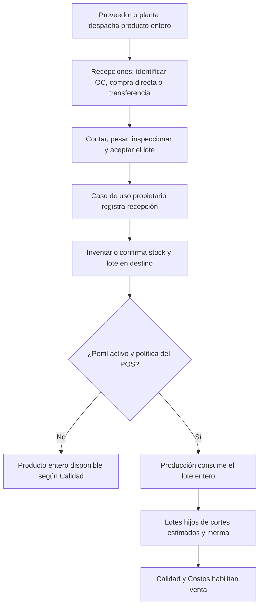

# Auditoría de recepción y despiece por rendimiento en puntos de venta

**Repositorio:** `jarralfa-max/pos_spj_v13.4`  
**Rama inspeccionada:** `claude/erp-financial-bounded-context-uqxz6b`  
**Commit inspeccionado:** `1980169ad7c72ce148b50cd3c54729850cb0586b`  
**Fecha:** 2026-10-26  
**Método:** lectura directa de casos de uso, UI, adaptadores, composición, eventos, esquema y pruebas existentes. No se usaron auditorías anteriores como evidencia.

## 1. Dictamen

**El flujo es implementable reutilizando la arquitectura actual, pero hoy no es automático ni está unificado en la pantalla de Transferencias.** Existe recepción de OC, compra directa y transferencia, así como transformación directa del lote con un perfil de rendimiento activo. Sus casos de uso son diferentes y deben seguir siéndolo: la recepción comercial afecta Compras y eventualmente CxP; el traslado entre sucursales mueve existencias; Producción consume el producto base y crea los subproductos. Una misma pantalla puede dirigir al caso de uso correcto sin crear una segunda fuente de verdad.

La condición empresarial central es que un rendimiento **estima** cuánto corresponde a cada corte: no convierte esos kilos en mediciones físicas. Se debe conocer al menos el peso neto real de entrada y conservar procedencia `ESTIMATED` hasta pesar o conciliar los componentes. La planta puede fabricar cortes de verdad; cuando manda carne entera al POS, la transformación debe ocurrir en el POS y sobre el lote recibido allí, no al despachar desde la planta.

## 2. Inventario de lo existente y brechas

| Capacidad | Evidencia en código | Estado y consecuencia |
|---|---|---|
| Recepción de OC | `backend/application/procurement/use_cases/purchase_order_use_cases.py:402-575` | Implementada: valida autorización, sucursal, perfil, tolerancia, lote/peso y `shipment_id`; registra `GoodsReceipt`, auditoría y evento `GOODS_RECEIPT_COMPLETED`; solo las cantidades aceptadas de mercancía entran a inventario. |
| Compra directa con recepción posterior | `backend/application/procurement/use_cases/direct_purchase_use_cases.py:604-725` | Implementada con recepciones parciales y `shipment_id`; existe también confirmación con recepción inmediata. No debe recibirse de nuevo una compra ya recibida. |
| Compra llegada en embarque | `backend/application/logistics/origin_purchase_workspace.py:398-462`; `frontend/desktop/modules/purchasing/enterprise_routes.py:130-166` | El espacio de origen agrupa conteos por OC/compra directa, llama los casos de Compras y cierra el embarque. Ya hay deduplicación por embarque y documento. No está dentro de la UI de Transferencias. |
| Entrada canónica de compras | `backend/application/procurement/integrations/wiring.py:72-82`; `backend/bootstrap/wiring/event_wiring.py:160-235`; `backend/application/event_handlers/inventory/purchase_stock_entry_bridge.py:43-69` | Los eventos llegan al ledger `PURCHASE_RECEIPT` y crean lotes. La explosión automática anterior de recetas se retiró expresamente. No agregar otra suscripción que contabilice dos veces la recepción. |
| Recepción intersucursal | `frontend/desktop/modules/transfers/pages/base_page.py:132-149`; `backend/application/transfers/cycle_service.py:123-132`; `backend/application/transfers/use_cases/transfer_receipt_use_cases.py:57-230` | La pantalla solo selecciona transferencia y embarque. El backend valida envío, saldo, parcialidad, permisos, segregación y cadena fría; guarda recepción, diferencias y eventos. |
| Entrada canónica de transferencia | `backend/infrastructure/integrations/transfers_inventory_gateway.py:190-253` | Publica `TRANSFER_RECEIPT` en destino, conserva lotes, separa aceptado, inspección y cuarentena. No debe pasar por Compras ni generar otra CxP. |
| Captura de peso de transferencias | `frontend/desktop/modules/transfers/dialogs/cycle_dialogs.py:87-122`; `backend/application/transfers/cycle_service.py:123-132`; `backend/application/transfers/use_cases/transfer_receipt_use_cases.py:123-151` | **Brecha P0:** UI/ciclo envían cantidad y aceptado; no envían peso, piezas, lote o temperatura aunque el comando y el backend soportan esos datos. Un producto `catch_weight` exige piezas y peso positivo y, con la UI actual, no puede recibirse correctamente. |
| Perfil y despiece directo | `backend/application/meat_processing/queries/direct_transformation_query_service.py:85-218`; `backend/application/meat_processing/integrations/products_recipe_snapshot_adapter.py`; `frontend/desktop/modules/meat_processing/dialogs_direct_transformation.py:125-185` | Ya se calcula previsualización desde perfil activo. El diálogo exige pesos por salida o permite marcar lo esperado como estimado con motivo. Es una acción aparte, después de recibir. |
| Ejecución de Producción | `backend/application/meat_processing/use_cases/direct_transformation_use_cases.py:60-201`; `backend/application/meat_processing/use_cases/order_execution_use_cases.py:91-158,415-535` | Reutiliza orden, reserva y consume lote, crea lotes hijos, genealogía, costeo, calidad y conciliación. Permiso específico, idempotencia y reanudación. La operación tiene commits entre etapas; no es atómica con la recepción. |
| Elegibilidad de almacén | `backend/application/meat_processing/queries/direct_transformation_query_service.py:91-167`; `backend/infrastructure/integrations/transfers_inventory_gateway.py:65-83` | **Brecha P0:** la transformación solo ve lotes en almacenes `PRODUCTION`, `AVAILABLE` y liberados; la transferencia elige destino con propósito `PURCHASE` si no se indicó almacén. La compra puede quedar en un almacén desde el que el despiece no encuentra el lote. |
| Marcado de estimación | `backend/application/meat_processing/use_cases/order_execution_use_cases.py:97-116,505-523`; `backend/infrastructure/db/schema/meat_processing_schema.py:716-742` | Las salidas llevan `weight_source=ESTIMATED` y motivo en `processing_output_results` y auditoría. El alta de lotes y existencias usa la cantidad capturada/estimada. Hace falta una política explícita sobre disponibilidad para venta y posterior conciliación. |

## 3. Riesgos precisos que resolver antes del modo automático

1. **Peso de entrada y unidad.** El perfil produce kilos por porcentaje del peso entrante. No inferir kilos por número de piezas ni confundir `quantity` con `weight`. `DirectTransformationQueryService.lots()` suma `inventory_balances.quantity` mediante `CAST(... AS REAL)` (`:130-151`), pese a que el backend de transferencias conserva `observed_weight` por separado; validar el contrato de unidades del ledger y consultar con Decimal sin pérdida de precisión. Si el producto llega por pieza, exigir báscula o un peso neto observado autorizado; sin ese dato, dejar la transformación pendiente.
2. **Orden temporal.** En compra, `GOODS_RECEIPT_COMPLETED` precede al puente `PURCHASE_STOCK_ENTRY_REGISTERED` y su proyección canónica. Disparar Producción antes de que el lote esté posteado y liberado da `LOT_NOT_AVAILABLE`. En transferencia también hay que esperar confirmación del ledger y eventual inspección. Usar evento de **stock disponible del lote confirmado** o un coordinador que verifique el asiento, no un simple clic ni un evento sin stock.
3. **Doble contabilización.** La propia composición advierte que conectar además `CanonicalInventoryCutover.wire()` a los eventos crudos duplicaría `PURCHASE_RECEIPT` (`backend/bootstrap/wiring/event_wiring.py:176-207`). Los cortes se deben crear solo mediante Producción; jamás sumarlos dentro de `ReceivePurchaseOrderUseCase`, `ReceiveDirectPurchaseUseCase` o `TransferReceiptAdapter`.
4. **Calidad, costos y venta.** La transformación existente verifica lote liberado y preflight de costeo. Algunas salidas entran en inspección por `quality_gate` (`order_execution_use_cases.py:415-473`). Un error o salida retenida no debe mostrarse como disponible para POS. El costo del producto base debe repartirse entre cortes según la política existente de Costos; no inventar costo por componente ni duplicar CxP.
5. **Procesamiento parcial y reintento.** `ExecuteDirectTransformationUseCase` guarda pasos y confirma cada fase (`direct_transformation_use_cases.py:100-193`); una recepción y sus etapas no forman una transacción única. Se requiere estado visible `RECIBIDO / TRANSFORMACIÓN PENDIENTE / EN PROCESO / COMPLETADO / BLOQUEADO`, operación durable e idempotencia por `receipt_line_id + lot_id + perfil_snapshot + intento lógico`, con reintento sin duplicar salidas.
6. **Origen trazable.** El query de Producción resuelve folio/proveedor mediante `goods_receipts` (`direct_transformation_query_service.py:171-180`); un lote recibido por transferencia no tiene necesariamente ese documento. Mostrar referencia de transferencia/embarque y el lote padre sin fingir una compra local.
7. **Permisos.** La UI compartida debe invocar las autorizaciones actuales `COMPRAS.recepcion.completar`, `COMPRAS.recepcion.crear`, permisos de recepción de transferencia y `PRODUCCION.transformacion_directa.ejecutar`. Un usuario autorizado para recibir no obtiene implícitamente permiso para transformar. Una política automática necesita identidad de servicio con concesión explícita y auditoría del operador causante, sucursal y almacén; respetar segregación y autorización separada de desvíos.

## 4. Flujo objetivo

**Ejemplo:** llegan 100.000 kg netos de canal entera con perfil versionado: corte A 35 %, B 45 %, subproducto C 15 %, merma 5 %. Después de aceptar y liberar el lote, Producción consume **100.000 kg**, registra **35.000 + 45.000 + 15.000 kg estimados**, y **5.000 kg de merma clasificada**; el saldo del producto base queda en cero. Esos pesos se presentan como estimados, no como pesajes. Si se pesan 92 kg reales entre cortes, la diferencia se concilia contra merma/desvío con evidencia y permiso según tolerancia. Si se permite vender antes de medir, debe definirse margen conservador y bloquear venta por encima del saldo estimado seguro. La recepción y el despiece quedan enlazados en genealogía, sin compra o entrada duplicada.

## 5. Diseño de implementación sin duplicar funciones

### A. Una bandeja de recepciones en Transferencias

Agregar rutas o secciones `Recepciones de compras` y `Recepciones intersucursal`, con búsqueda por folio, proveedor/origen, destino, embarque, estado y escaneo. Un `ReceivingInboxQueryService` devuelve DTOs del documento y su línea, enlazando lectura de Compras y Transferencias sin replicar repositorios ni reglas. En el detalle, capturar cantidades, **peso neto de entrada**, piezas, lote, caducidad, temperatura, rechazos y diferencias usando los componentes canónicos. El comando resultante despacha por tipo real:

| Documento | Caso de uso que conserva la escritura | Condición |
|---|---|---|
| OC | `ReceivePurchaseOrderUseCase` | OC recibible; línea y perfil validados. |
| Compra directa pendiente | `ReceiveDirectPurchaseUseCase` | Confirmada y no recibida inmediatamente. |
| Embarque de compra en origen | `OriginPurchaseWorkspaceService.receive_and_close` | Conteos terminados; conserva deduplicación embarque/documento. |
| Embarque entre sucursales | `ConfirmTransferReceiptUseCase` | Shipment despachado, sucursal destino y segregación. |

No cambiar semántica de Transferencias para hacer de toda compra una transferencia. La bandeja es una vista de trabajo común; Compras y Transferencias conservan propiedad de sus documentos. La compra sin OC puede seguir el flujo de compra directa existente. En transferencias, completar la adaptación UI → `ReceiveTransferLineCommand` de pesos/piezas/lotes/temperatura y mostrar estado de Calidad.

### B. Política de transformación por sucursal, producto y destino

Configurar en fuente canónica de Productos/Producción una política con alcance `branch_id + product_id + warehouse_id` y modos `NO_TRANSFORMAR`, `OFRECER_AL_RECIBIR` y `AUTO_ESTIMAR_AL_RECIBIR`; definir si cubre OC, compra directa, traslado desde planta o todos, y desde qué fecha/versión aplica. El perfil activo congelado sigue siendo la única fuente de porcentajes; validar suma <= 100 %, subproductos activos, unidades y merma. Sin perfil activo, peso neto, costo, ubicación productiva, calidad liberada o permiso técnico, marcar pendiente con razón; **no fingir una recepción fallida** si la mercancía sí llegó.

Un coordinador durable escucha/consulta confirmación del inventario de la línea aceptada, resuelve su lote canónico y genera una petición idempotente a `ExecuteDirectTransformationUseCase` con salidas de `DirectTransformationQueryService.preview()` y `estimated_product_ids` para todas las salidas que no se pesaron; motivo estable: “estimación automática según perfil vX en recepción Y”. No ejecutar con rechazo, cuarentena ni saldo no disponible. Reutilizar eventos y outbox existentes y añadir únicamente el contrato/handler que falte, conectado en el composition root real. Persistir referencia de recepción, línea, transferencia/embarque, lote padre, orden de Producción, versión del perfil, actor, operación y estado; asociar cada resultado y error reintentable.

**Decisión operativa por validar:** si en POS toda canal recibida se despieza físicamente antes de vender, `AUTO_ESTIMAR_AL_RECIBIR` es razonable una vez medido el peso total. Si puede quedar entera o viajar de nuevo, `OFRECER_AL_RECIBIR` evita consumirla contablemente antes del despiece real. En planta la política habitual sería despiece por orden con pesos reales, no automática para todo producto con perfil.

### C. Visibilidad y conciliación

En la recepción mostrar “Entraron 100 kg enteros; transformación pendiente/terminada; cortes estimados” y una tabla con `esperado`, `pesado`, `diferencia`, `estado de calidad`, `costo` (según permiso) y `disponible para venta`. Permitir pesajes posteriores por corte con un caso de conciliación del lote estimado: ajustar inventario con movimientos auditados, recalcular diferencias y costo conforme política, sin editar el ledger original ni sobrescribir el perfil usado. Etiquetas y tickets deben distinguir peso estimado del peso real.

## 6. Orden de trabajo y criterios de aceptación

| Prioridad | Cambio | Comprobación |
|---|---|---|
| P0 | Corregir captura de peso, piezas y lote en recepción de transferencias y contrato de unidades `quantity/weight`. | Una transferencia de producto `catch_weight` se recibe en destino con peso observado y lote; un faltante/retención no se transforma. |
| P0 | Seleccionar/transferir al almacén elegible `PRODUCTION` sin cambiar existencias dos veces; resolver lote de compra o traslado. | Recepción en almacén de compra queda pendiente o movimiento interno autorizado; el lote aparece en consulta de transformación cuando está disponible. |
| P0 | Bandeja compartida de recepciones con enrutamiento a tres casos propietarios y permisos independientes. | OC, compra directa sin OC y transferencia se reciben desde la nueva UI; cada una produce **una** sola entrada canónica, la factura/CxP solo corresponde a Compra. |
| P1 | Política por POS y coordinador durable que invoca la transformación existente tras stock confirmado. | Reenvío/reinicio/offline no crea otra orden ni otros lotes; fallas intermedias son visibles y reanudables. |
| P1 | Pruebas de 100 kg, porcentajes versionados, merma, calidad, costo, permisos y conciliación. | Producto base baja una vez, los cortes y lotes hijos suben una vez, genealogía/costo/estimación quedan rastreables. |
| P2 | UX de pesaje posterior y saldo estimado seguro. | Desvíos o venta superior a saldo permitido requieren ajuste o autorización trazable. |

**Verificación de esta auditoría:** se inspeccionaron directamente los archivos enumerados. Existen pruebas para compras en `tests/integration/procurement/test_pipeline_end_to_end.py` y estimación/despiece en `tests/integration/meat_processing/test_production_audit_32cfbf.py`. Se intentó ejecutar ambas suites, pero el Python disponible en este entorno no tiene `pytest` y el intérprete del entorno virtual local no existe; por ello no se declara que hayan pasado. No se cambió lógica de producción en esta auditoría.
