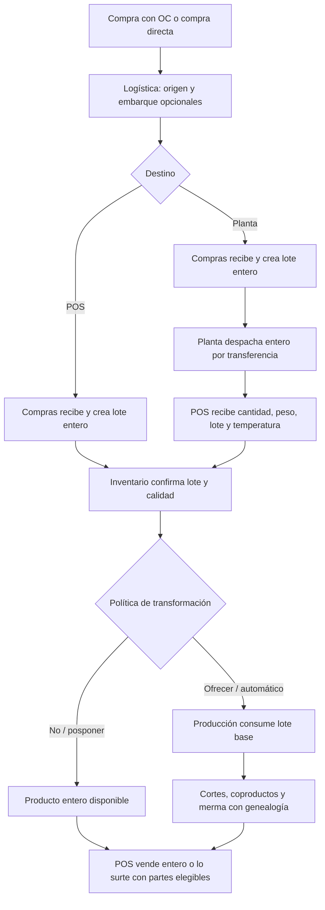

# Auditoría integral: Producción, Recepción, Transferencias, Productos y Precios

**Repositorio:** `jarralfa-max/pos_spj_v13.4`  
**Rama:** `claude/erp-financial-bounded-context-uqxz6b`  
**Commit remoto auditado:** `ee449a822d628d12b41e19e765ec94b93316fe06`  
**Fecha:** 26 de octubre de 2026  
**Alcance:** lectura directa de dominio, casos de uso, repositorios, pantallas, composición, esquemas y pruebas. El árbol de archivos auditado coincide con el de la rama remota. Las observaciones se refieren al código, no a los informes previos.

## 1. Dictamen ejecutivo

La arquitectura **contiene las piezas centrales**, pero todavía no ofrece una operación continua y segura para el flujo real de SPJ: compra con o sin OC → embarque/recepción → producto entero en POS → despiece estimado o pesado → venta de cortes, combinaciones o producto base reconstruible. Compras y Transferencias ya pueden recibir sus documentos; Producción ya sabe transformar un lote mediante un rendimiento versionado; Inventario registra movimientos y Ventas puede surtir virtualmente el producto base desde sus partes. Falta la **orquestación entre recepción y transformación**, y hay fallas concretas de captura, unidades y determinismo de precios.

La planta no debe desagregar en inventario del punto de venta un producto que despacha entero. El POS recibe y pesa el producto base; allí se registra la transformación, con sus salidas como **estimadas** cuando no se pesan individualmente. Es necesario diferenciar físicamente el lote disponible, el lote retenido, la merma y la diferencia de rendimiento. Una estimación no equivale a un pesaje.

No recomiendo que «tener perfil activo» dispare por sí solo el consumo: debe existir una política explícita por producto, sucursal y almacén, y el lote debe haberse recibido, posteado, liberado y localizado en un almacén elegible. La recepción comercial y el despiece conservan propietarios distintos.

## 2. Flujo existente y fuente de verdad

| Paso | Implementación verificada | Fuente de verdad / límite |
|---|---|---|
| Catálogo, recetas, rendimiento y despiece | `backend/application/products/use_cases/product_yield_use_cases.py`; `backend/application/meat_processing/integrations/products_recipe_snapshot_adapter.py` | Productos define una versión activa y Producción congela su snapshot. Perfil de rendimiento y esquema de corte se comparan; el perfil manda en los kg esperados. |
| Compra con OC | `backend/application/procurement/use_cases/purchase_order_use_cases.py`, `ReceivePurchaseOrderUseCase` | Compras valida líneas, tolerancia acumulada, lote, peso y aceptación; emite `GOODS_RECEIPT_COMPLETED`. |
| Compra sin OC | `backend/application/procurement/use_cases/direct_purchase_use_cases.py`, `ReceiveDirectPurchaseUseCase` | Existe compra directa confirmada con recepción posterior o inmediata; admite parcialidad, `shipment_id` y cuentas por pagar según el caso. |
| Carga en origen y llegada | `backend/application/logistics/origin_purchase_workspace.py`, `receive_and_close` | Logística cuenta y vincula embarque con OC o compra directa; delega la recepción en Compras, con consulta previa para evitar recibir dos veces el mismo documento. |
| Entrada de compra al inventario | `backend/application/procurement/integrations/wiring.py`; `backend/bootstrap/wiring/event_wiring.py`; `backend/application/event_handlers/inventory/purchase_stock_entry_bridge.py` | El traductor y el puente canónico crean `PURCHASE_RECEIPT` y lote. No registrar una segunda entrada desde Producción o la bandeja de Transferencias. |
| Transferencia intersucursal | `backend/application/transfers/use_cases/transfer_receipt_use_cases.py`; `backend/infrastructure/integrations/transfers_inventory_gateway.py` | Transferencias valida envío, peso, piezas, lote, segregación, alcance y calidad; destino recibe `TRANSFER_RECEIPT`, no una compra local. |
| Despiece directo | `backend/application/meat_processing/use_cases/direct_transformation_use_cases.py`; `backend/application/meat_processing/use_cases/order_execution_use_cases.py` | Producción consume el lote base y produce lotes hijos con genealogía, calidad y costeo; registra `ESTIMATED` o `CAPTURED` por salida. |
| Venta de cortes o base armable | `backend/application/inventory/queries/sellable_availability_query_service.py`; `backend/infrastructure/integrations/sales_inventory_client.py` | Se pueden vender cortes por separado. La reconstrucción vigente es **virtual al vender**: si faltan unidades base y todas las partes requeridas alcanzan, se reservan y descuentan las partes. No crea stock físico del producto base. |
| Precio de venta | `backend/application/pricing/queries/product_price_query_service.py`; `backend/infrastructure/integrations/sales_pricing_client.py` | Precios resuelve BASE, canal POS, cliente y volumen; Ventas consulta al agregar/recalcular líneas. El formulario de Productos no es el propietario del precio. |

## 3. Hallazgos verificables y prioridad

### P0 — La recepción de transferencias no captura los datos que exige el dominio

`frontend/desktop/modules/transfers/dialogs/cycle_dialogs.py::ReceiveTransferDialog` recoge cantidad y casilla de aceptación. `backend/application/transfers/cycle_service.py::receive` construye `ReceiveTransferLineCommand` sin peso, piezas, lote, temperatura ni caducidad; los defaults son peso/piezas cero. `ConfirmTransferReceiptUseCase` rechaza un producto `catch_weight` si peso o piezas son cero y exige lote cuando el perfil lo indica. Por lo tanto, un traslado de canal entera con ese perfil **no puede recibirse correctamente desde esta pantalla**, aun cuando el backend tenga el contrato necesario. Además, una línea con peso despachado positivo puede quedar parcialmente recibida por peso cero. **Acción:** ampliar diálogo, DTO del detalle y adaptador del ciclo; exigir neto observado, piezas, lote/identidad, fecha y temperatura según perfil; pruebas UI → comando → ledger para recepción completa y parcial.

### P0 — El almacén por defecto de la transferencia no alimenta el despiece directo

`transfers_inventory_gateway.py::_destination` busca un almacén de propósito `PURCHASE` si no se eligió uno; `direct_transformation_query_service.py::lots` sólo consulta almacenes `PRODUCTION`, saldos `AVAILABLE` y lotes de productos con perfil activo. Una canal recibida puede quedar invisible para Producción. **Acción:** seleccionar explícitamente almacén destino en recepción y, si difiere del de producción, efectuar movimiento interno autorizado y trazable. Nunca modificar el saldo desde la UI ni fingir que son dos recepciones.

### P0 — No hay disparador transaccional entre recepción y transformación

`DirectTransformationPage` ofrece una acción separada sobre lotes ya disponibles. `ExecuteDirectTransformationUseCase` crea/registra una orden y guarda avances mediante commits entre etapas; no forma una sola transacción con Compras o Transferencias. Un evento de recepción puede preceder al asiento efectivo del lote. **Acción:** coordinar mediante estado durable de la línea recibida y la confirmación de Inventario; solicitar transformación una sola vez con identificador idempotente estable. Exponer `RECIBIDO`, `PENDIENTE_DE_LOTE`, `ESPERA_CALIDAD`, `PENDIENTE_DE_MOVIMIENTO`, `TRANSFORMANDO`, `COMPLETADO` y `ERROR_REINTENTABLE`.

### P0 — Unidades y precisión de la disponibilidad productiva

`direct_transformation_query_service.py::lots` suma `inventory_balances.quantity` con `CAST(... AS REAL)` y presenta el resultado como `available_kg`. Una cantidad de piezas no equivale automáticamente a kg; `REAL` pierde precisión Decimal. El ledger de Transferencias distingue `observed_quantity` y `observed_weight`. **Acción:** definir por producto unidad base, unidad inventariable, piezas y peso neto; consultar el peso/cantidad canónicos con Decimal y conversión explícita. Si falta peso neto para un perfil expresado en kg, impedir el despiece automático y solicitar pesaje.

### P0 — El POS puede perder condiciones financieras del precio resuelto

`PricingResolutionService` marca `below_minimum`, pero `PricingReadFacade.sale_price_amount` y `SalesPricingClient.effective_price` entregan sólo el número; `backend/application/sales/pricing_resolution.py` atrapa cualquier excepción y retorna `None`, lo cual lleva al precio del catálogo. Ante un acuerdo por cliente, un error de consulta puede cambiar silenciosamente el importe cobrado. **Acción:** transportar un resultado de precio con origen, versión, mínimo y estado; diferenciar «no hay precio configurado» de «falló el motor»; bloquear o requerir autorización trazada ante error o piso vulnerado, con la política financiera de SPJ.

### P1 — Rendimiento estimado y calidad requieren política para venta y conciliación

`DirectTransformationDialog` permite copiar porcentajes esperados a las salidas y exige motivo; `order_execution_use_cases.py` conserva `weight_source=ESTIMATED` y motivo en resultados. El movimiento físico de salidas usa esos kg estimados. Aún falta una política de disponibilidad segura y un flujo visible para pesar después, conciliar diferencias y revertir o ajustar sin sobrescribir la genealogía original. **Acción:** permitir venta de saldo estimado sólo según configuración y tolerancia; registrar pesajes posteriores por lote/corte y movimientos compensatorios auditados. Nunca presentar estimado como pesado.

### P1 — Reconstrucción virtual: confirmar reglas de kg, merma y precio compuesto

`SellableAvailabilityQueryService` y `SalesInventoryClient` calculan disponibilidad armable desde el esquema de corte reversible y consumen partes al cobrar. El motor falla conservadoramente ante esquema ambiguo y exige todas las partes; su prueba de cobro depende de autenticación disponible en el entorno. La decisión de negocio sigue pendiente para venta por kg del producto base con cortes de pesos distintos y merma real: definir equivalencias, redondeo, saldos por lote y origen del costo. Mantener distinta la venta virtual del **reensamble físico**, que requeriría otra orden de Producción si el negocio realmente arma una unidad nueva.

### P1 — Cambiar un único precio obliga a duplicar toda la lista

`PriceList.is_editable` sólo permite borrador/revisión. `product_prices_page.py::_edit` ofrece duplicar la lista íntegra; `DuplicatePriceListUseCase` copia todos sus productos. El esquema de `product_price` tiene `UNIQUE(price_list_id, product_id, branch_id)`: `effective_from/to` existen pero no pueden convivir dos versiones de una misma línea. **Acción:** «Cambiar precio» en una lista aprobada crea una revisión de **esa línea**, con vigencia, motivo, autor, aprobador, mínimo y evento; el histórico aprobado no se reescribe. Aprobación de una revisión sin republicar cientos de productos. La consulta canónica debe elegir la versión efectiva sin intervalos solapados.

### P1 — Asignación de precios especiales por cliente ambigua

`ProductPriceQueryService` ya toma un precio de una lista CUSTOMER si el producto figura allí y, si no, cae al canal/base. El POS recalcula líneas al asignar cliente (`AssignCustomerToSaleUseCase`). Sin embargo, `PricingRepository.assign_customer_list` es un `INSERT OR IGNORE` sin caso de uso público ni UI revisada, `customer_price_list` permite varias listas por cliente y `customer_list_id` usa `LIMIT 1` sin orden. **Acción:** administrar una lista sparse por cliente o por segmento con asignación única vigente por cliente/sucursal/canal; altas, reemplazos y bajas con permiso `PRECIOS.lista.cliente.asignar`, fechas y auditoría. Una sola regla canónica de prioridad; definir si un tier por volumen reemplaza o complementa un precio negociado y si el descuento global se acumula.

### P1 — La bandeja de Transferencias aún no incluye compras

`ReceiveTransferDialog` sólo opera sobre un `transfer_id` y `shipment_id`; Compras tiene sus propios casos de uso, y Logística puede recibir OC/compra directa de un embarque. **Acción:** agregar a la navegación una **bandeja de recepciones** con dos tipos, `Compra` y `Transferencia`, alimentada por QueryServices. Enrutamiento: OC → `ReceivePurchaseOrderUseCase`; compra sin OC → `ReceiveDirectPurchaseUseCase`; embarque de origen → servicio de llegada de Logística; traslado → `ConfirmTransferReceiptUseCase`. Los permisos de ambos contextos permanecen independientes y sólo Compras provoca factura/CxP.

### P1 — Alertas de stock están implementadas, con alcance operativo que validar

`ProductFormDialog` permite guardar mínimo/objetivo por almacén; `StockMinimumMonitor` consulta saldos disponibles con Decimal, deduplica y envía a campana y cola de WhatsApp; está registrado como tarea periódica en `desktop_shell_window_composition.py`. Ya no corresponde reportarlo como inexistente. La resolución de usuarios destinatarios en `ProductSettingsQuery.alert_user_ids` lee el campo `usuarios.rol` como texto y teléfonos globales para WhatsApp. **Acción:** alinear destinatarios con la fuente canónica RBAC y alcance de sucursal, permitir responsables por almacén, diagnosticar servicio/sincronización y verificar persistencia de la cola en el `.exe` y escenarios offline. No crear otro centro de notificaciones.

### P2 — La UI de Productos separa reglas operativas y no indica ruta de precio

El formulario actual tiene datos maestros, capacidades, imagen y mínimo; recetas, rendimientos, esquemas e imágenes adicionales están en «Más acciones» del catálogo. El precio permanece correctamente en Precios, pero un operador puede no saber cómo completarlo al dar de alta un producto. **Acción:** ficha guiada «Datos → Operación/almacenes → Imagen → Comercialización», con enlace contextual a capturar precio en la lista vigente/borrador; búsquedas canónicas de producto y almacén, vista previa por sucursal/canal y estado de activación. Reutilizar `StandardDialog`, `SearchInput`, `StandardTable`, tokens y botones existentes.

## 4. Diseño operativo propuesto

**Condición temporal:** para compras, esperar el asiento de `PURCHASE_STOCK_ENTRY_REGISTERED` y la creación/liberación del lote; para transferencias, esperar la confirmación de `TRANSFER_RECEIPT` en el destino. Un recibo rechazado o en cuarentena no se despieza ni se ofrece a Ventas. La planta puede tener órdenes productivas propias, pero el traslado a POS sale como producto entero cuando así opera SPJ.

**Política por destino:** `NEVER`, `OFFER_AFTER_RECEIPT`, `AUTO_ESTIMATE_AFTER_RECEIPT`, con alcance `product_id + branch_id + warehouse_id + source_kind`, versión efectiva, perfil aprobado, almacén elegible y actor técnico autorizado. El modo automático sólo se habilita cuando el despiece físico ocurre realmente al recibir y se capturó el neto real del producto base. Si la mercancía puede seguir entera, elegir `OFFER` y conservar su existencia hasta transformar.

**Ejemplo de 100 kg recibidos:** perfil activo A 35 %, B 45 %, C 15 % y merma 5 %. Producción consume el lote padre de 100 kg; registra 35/45/15 kg como `ESTIMATED` si no hubo báscula por salida y 5 kg como merma clasificada. Conserva lote, versión del perfil, razón de estimación, origen comercial, costo y vínculo a salidas. La venta de un corte usa el precio propio de ese SKU; la venta de un combinado/entero armado usa su precio comercial mientras el inventario descuenta componentes reales conforme al esquema reversible.

## 5. Matriz de decisiones de producto, inventario y precio

| Artículo vendido | Cómo se surte | Precio | Guardas |
|---|---|---|---|
| Producto entero disponible | Su propio lote | Precio del entero vigente por sucursal, cliente y canal | Peso real, lote, calidad y reserva. |
| Corte separado | Lote hijo del corte | Precio propio del corte | No confundir rendimiento estimado con peso pesado. |
| Combinación virtual | Componentes de receta `SALES_EXPLOSION` o bundle virtual | Precio del producto compuesto | Componentes completos, stock suficiente, costo/margen calculados desde las partes. |
| Producto entero reconstruible virtualmente | Su stock directo y, para el faltante, todas las partes del esquema reversible | Precio comercial del entero | No crear saldo ficticio del entero; verificar lote, kg, merma y costo. |
| Cliente con acuerdo para un corte | Igual inventario que la línea correspondiente | Revisión vigente de lista CUSTOMER; otros productos heredan canal/base | Asignación determinista, vigencia, mínimo y no acumulación accidental de descuentos. |

El perfil de rendimiento sirve para **prever salidas del despiece**; la receta/BOM de producción sirve para **consumir insumos y fabricar**; el esquema de corte define **partes y reconstrucción virtual**; una receta de venta/bundle describe **componentes consumidos al vender**. Mantener estos conceptos y sus versiones separados evita que la compra genere cortes por accidente.

## 6. Arquitectura, permisos y protección financiera

- UI de Recepciones: consulta agregada y DTO común, sin escribir inventario. Debe invocar los casos propietarios existentes; un `ReceivingInboxQueryService` no sustituye los repositorios de Compras o Transferencias.
- Coordinator de transformación: petición durable por `receipt_line_id + inventory_lot_id + yield_version_id + logical_attempt`; una operación UUIDv7 por comando/evento y restricción de unicidad de la clave de negocio. Reutilizar outbox, bus, políticas y composition root actuales. Reintentos no duplican consumo, lotes ni costo.
- Permisos: quien recibe compra necesita su permiso de Compras; quien recibe traslado, el de Transferencias en destino; quien ejecuta producción, `PRODUCCION.transformacion_directa.ejecutar`; quien modifica/aprueba precios, permisos granulares de Precios. Automatizaciones deben operar bajo identidad técnica autorizada con actor causante y alcance auditados. No conceder Producción implícitamente por poder recibir.
- Protección financiera: sólo aceptado crea existencias y compromiso de compra; rechazado/diferencia se trata por Compras y Calidad. Producción redistribuye costo de la materia prima entre salidas según su política vigente; no abre otra CxP ni vuelve a reconocer una compra. El mínimo de precio y margen se verifican sobre el resultado efectivo del cliente/volumen y sobre el costo real de componentes cuando la venta es virtual.
- Competencia/offline: validar estado esperado y versión del lote, reserva atómica, lotes liberados, operador/sucursal/almacén. Registrar pendiente y conflicto visible; no aplicar last-write-wins al peso, recepción, transformación o precio aprobado.

## 7. Plan ejecutable y criterios de aceptación

| Fase | Entrega | Evidencia mínima |
|---|---|---|
| 0 | Pruebas de protección para unidades, recepción, ledger, rendimientos, surtido y precios actuales | Un recibo aceptado produce una entrada; una transformación produce un consumo y salidas; una venta consume sólo los SKU reservados. |
| 1 | Captura completa de traslado y selección de almacén elegible | Recibir canal con piezas/peso/lote/temperatura desde UI; rechazo y cuarentena no pasan a venta. |
| 2 | Bandeja unificada de compras y traslados | OC, compra directa sin OC y transferencia se reciben desde la misma entrada visual, cada uno por su caso de uso y permiso. |
| 3 | Política de transformación y coordinador con reintentos | Compra o traslado confirmados crean petición una vez; falta de lote/calidad/peso deja estado pendiente; reiniciar no duplica stock. |
| 4 | Conciliación de cortes estimados y protección financiera | Pesar después corrige por movimientos auditados; lote/costo/genealogía siguen íntegros; no se venden retenidos. |
| 5 | Revisión puntual de precios y asignación de lista CUSTOMER | Cambiar sólo un SKU sin duplicar la lista; dos listas vigentes no compiten; POS muestra origen, mínimo y precio pactado. |
| 6 | UI guiada, destinatarios de stock y diagnóstico | Producto nuevo enlaza a Precios, mínimo por almacén avisa al responsable, WhatsApp fallido queda visible y reintentable. |

**Casos de aceptación imprescindibles:** 100 kg enteros desde planta a POS; compra directa sin OC; recepciones parciales y lote distinto; diferencias y cuarentena; salida estimada vs medida; despiece con tolerancia y merma; venta individual, paquete y base virtual; cliente con precio especial de un solo corte; volumen y mínimo; reintento offline y doble evento; separación de funciones; cinco sucursales con almacenes diferentes.

## 8. Verificación y límites

Se leyeron directamente los archivos citados y se comprobó mediante GitHub que el commit remoto de la rama no avanzó respecto a `ee449a82`; el checkout inspeccionado tiene el mismo árbol de archivos. No se realizaron cambios funcionales.

- `tests/integration/meat_processing/test_production_audit_32cfbf.py` y `tests/integration/procurement/test_pipeline_end_to_end.py`: **22 pasaron**.
- `tests/unit/test_transfers_receipt_use_cases.py`, `tests/integration/pricing/test_pricing_query_services.py`, `tests/integration/inventory/test_stock_minimum_inbox.py` y `tests/integration/test_reverse_reconstruction_from_cutting_scheme.py`: **26 pasaron, 1 falló al construir POS** porque el intérprete de esta auditoría no incluye `argon2-cffi`. Ese resultado no demuestra un defecto funcional de reconstrucción; la ruta de cobro queda sin validar aquí.
- No se hizo prueba manual con báscula, ticket, WhatsApp real, instalación Windows ni sincronización entre equipos; los efectos descritos se infieren de los contratos y rutas inspeccionados. Una ejecución piloto con base limpia y hardware real es condición para declarar el flujo operativo completo.

**Conclusión:** la implementación debe concentrarse en completar contratos y enlazar capacidades existentes, sin duplicar motores de recepción, stock, producción, precios, alertas ni permisos. La brecha más urgente es poder recibir correctamente producto cárnico de peso variable en el POS; después, confirmar el lote disponible y orquestar el despiece con estimación explícita. Las revisiones puntuales y acuerdos por cliente completan el circuito de venta sin reescribir listas aprobadas.
