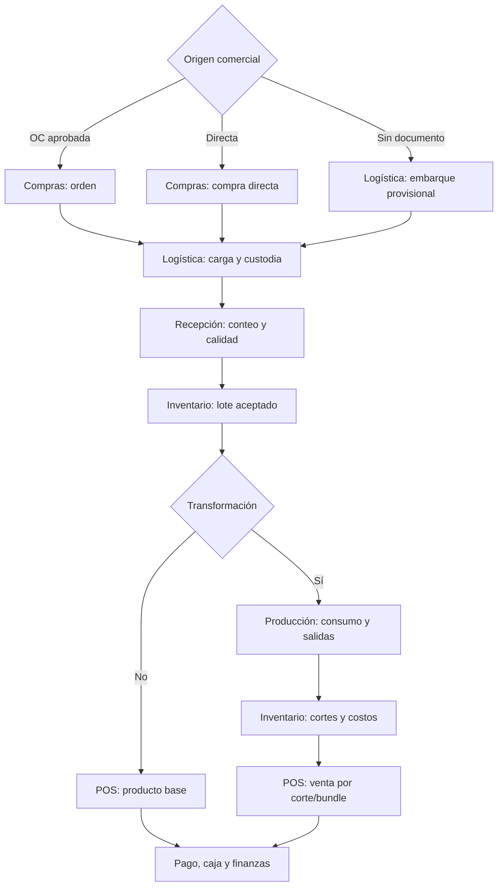

# Appflow — De compra a venta y cierre

## 1. Recorrido operativo objetivo

El tramo **sin documento** es propuesto; el servicio actual `OriginPurchaseWorkspaceService.create_shipment` exige documento. No permite reconocer costo, CxP ni stock vendible hasta regularizar compra y recepción. El tramo de compra directa sí existe: documento confirmado, sin OC, y `fulfillment_mode` adecuado para recoger en origen.

## 2. Hitos y responsables

| Paso | Acción del operador | Regla/resultado | Código revisado |
| --- | --- | --- | --- |
| 1. Producto | Configurar unidad, tipo, rendimiento/esquema, precio por parte, impuestos | Versionar perfil; ninguna variación de precio altera venta pasada | `backend/infrastructure/db/schema/products_schema.py`, `pricing_schema.py` |
| 2. Compra | Crear/autorizar OC o compra directa; proveedor, líneas, costo y sucursal | El documento es fuente de verdad comercial | `backend/application/procurement/use_cases/purchase_order_use_cases.py`, `direct_purchase_use_cases.py` |
| 3. Carga | Crear embarque y asociar contenedores/líneas, pesos, foto, sello | Logística posee custodia física; no contabiliza stock | `backend/application/logistics/origin_purchase_workspace.py`, `backend/application/logistics/service.py` |
| 4. Llegada | Escanear y pesar; comparar con declarado; documentar discrepancia | Recepción acepta/rechaza/cuarentena; operación idempotente | `backend/application/procurement/use_cases/`, `backend/application/logistics/origin_purchase_workspace.py` |
| 5. Entrada | Aplicar evento de compra aceptada al ledger/lote | Una única ruta canónica, sin doble handler | `backend/bootstrap/wiring/event_wiring.py`, `backend/application/event_handlers/inventory/purchase_stock_entry_bridge.py` |
| 6. Transformación | Seleccionar lote, esquema, peso; registrar cortes, subproductos y merma reales | Consumir base, crear lotes salida, costo/genealogía en una operación | `backend/application/meat_processing/use_cases/order_execution_use_cases.py` |
| 7. Venta | Buscar/escáner, peso o piezas, cliente, precio vigente y disponibilidad | Reservar por producto/lote; aplicar protección de margen/beneficios | `backend/application/sales/use_cases/cart_use_cases.py`, `inventory_use_cases.py` |
| 8. Cobro | Elegir pagos; validar vale/cupón/puntos; confirmar | Registrar venta, pago, caja, eventos y ticket una vez | `backend/application/sales/use_cases/payment_use_cases.py`, `backend/application/cash_register/` |
| 9. Cierre | Corte X/Z, entrega y contabilización | Mostrar pendientes por evento y conciliación | `backend/application/cash_register/z_cut_use_cases.py`, `backend/application/event_handlers/finance/` |

## 3. Decisiones y excepciones

**Compra sin PO:** el usuario registra compra directa, la confirma y selecciona «recoger en proveedor». El documento habilita carga/recepción. Un embarque provisional sin ningún documento requiere nuevo flujo de conciliación; no convertir un embarque en una compra implícita.

**Recepción desde Compras o Transferencias:** ambas vistas pueden iniciar la misma acción de recepción si el origen es diferente; el inventario debe reconocer `source_type`, `source_id`, `operation_id` y la línea de recepción. La recepción de transferencia pertenece a su caso de uso; la UI actual debe comprobarse antes de prometer esa ruta integrada.

**Cuarentena:** la existencia física puede estar presente sin ser vendible. Calidad decide liberar o rechazar; sólo entonces cambia disponibilidad.

**Producción directa:** la misma política de consumo/salidas admite entrada desde una orden o desde «Transformar ahora»; no crear un segundo motor de producción. Calcular salida prevista por perfil (%) y comparar con peso real. Ejemplo: 100 kg entrada, cortes 35/25/12/20 kg y 8 kg merma; reconciliar costo de 100 kg entre salidas, merma y variaciones aprobadas.

**Reconstrucción:** si se venderá una presentación física del producto base, confirmar que cada componente está disponible, consumirlos y crear base con trazabilidad. Para vender un paquete comercial de cortes, reservar y descargar los cortes como bundle virtual. La rama tiene `ReconstructBaseProductUseCase` y un top-up desde POS; hay que probar atomicidad ante fallo intermedio antes de activarlo para cierre real.

**Política de beneficios:** no cobrar dos veces ni canjear dos veces un cupón. Vales de varios usos consumen saldo según porcentaje configurado y límite financiero por evento; cupones de un uso pasan a consumido atómicamente. Devolución revierte inventario, caja/medio de pago, puntos y asiento con referencia a la venta original.

## 4. Estados que deben aparecer en pantalla

| Objeto | Estados mínimos de recorrido | Condición de salida |
| --- | --- | --- |
| Compra | Borrador → aprobada/confirmada → recibida parcial/completa → conciliada | Diferencias y factura resueltas. |
| Embarque | Borrador → carga → sellado → en tránsito → llegado → recibido/cerrado | Custodia transferida, conteo y discrepancias. |
| Lote | Pendiente/calidad → disponible/reservado → consumido/vendido | Ledger y trazabilidad íntegros. |
| Producción | Borrador → en ejecución → salida capturada → conciliada/cerrada | Masa y costo dentro de política. |
| Venta | Activa → checkout → pago pendiente → completada/devuelta | Reserva y pagos confirmados; eventos entregables. |
| Caja | Abierta → conteo → corte → entrega/cerrada | Diferencias autorizadas y finanzas notificadas. |

Los nombres exactos de enum/DB deben cotejarse antes de implementar transiciones; la tabla expresa el recorrido que el usuario necesita.

## 5. Riesgos actuales que bloquean el recorrido

1. `frontend/desktop/modules/meat_processing/dialogs.py` obtiene producto desde la opción seleccionada al cerrar; el selector puede perder su selección al refrescar. Conservar `product_id` capturado y validar antes de aceptar.
2. En el cálculo de producción, un esquema de corte expresa `quantity` como factor mientras el perfil expone porcentaje de rendimiento; verificar coherencia de fórmula y unidad antes de sugerir kilos.
3. `backend/bootstrap/wiring/event_wiring.py` deja fuera `wire_logistics()`. Una clase y eventos existentes no prueban integración viva.
4. Una recepción puede alimentar rutas distintas de inventario si se activa además el cutover adicional. Probar exactamente un movimiento por línea aceptada.
5. `backend/application/logistics/origin_purchase_workspace.py::receive_and_close` deriva un UUID5 para una operación; alinear con el contrato de UUIDv7/idempotencia sin perder el vínculo al evento original.

## 6. Prueba end-to-end exigida

En DB nueva y usuario acotado: comprar 100 kg directamente sin OC → cargar 1 contenedor → despachar y recibir 98 kg, rechazar 2 kg → inventario 98 kg aceptados → transformar 90 kg con 4 cortes y merma → vender 1 corte por peso y un bundle → pagar parcialmente en efectivo y otro medio → emitir ticket → corte Z → verificar sumas de ledger, asientos balanceados, costo/genealogía, outbox sin pendientes permanentes y ausencia de doble registro al reintentar cada comando. Repetir con calidad bloqueada, permiso denegado y red desconectada.
