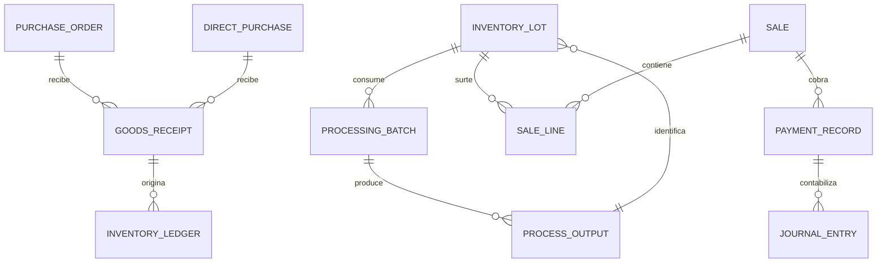

# Backend schema — esquema lógico desde cero y referencia actual

El esquema físico actual se inventaría en §2–4. El modelo **objetivo** de plataforma central, web y WhatsApp se especifica en §7–10; no interpretar las tablas propuestas como migraciones existentes.

## 1. Convención

Este documento registra tablas **existentes en fuentes DDL** del commit `32cfbf278e9fdc600ae8953be842626a455c3b4a` y propone relaciones de integración. No es un volcado completo de SQLite ni garantiza que todas las migraciones se ejecuten en instalaciones actuales. Antes de alterar tablas, inspeccionar `migrations/` y los módulos de `backend/infrastructure/db/schema/`; el DDL de varios contextos está en estos últimos y se invoca desde una migración. En la rama coexisten tablas canónicas y algunas tablas históricas: confirmar la ruta runtime antes de eliminarlas.

| Norma | Contrato |
| --- | --- |
| Identidad | `id TEXT PRIMARY KEY` UUIDv7 en minúsculas; folio/código comercial independiente. |
| Referencias | `*_id TEXT`; FK física dentro de un contexto cuando exista; entre contextos validar por servicio/contrato, sin copiar maestro. |
| Precisión | Cantidad, peso, costo, dinero como texto decimal normalizado en SQLite y `Decimal` en Python. |
| Concurrencia | `operation_id` UNIQUE; `version` optimista en agregados mutables; restricciones de estado y unicidad. |
| Historia | Nunca borrar movimientos/asientos; reversa explícita con referencia al original. |
| Eventos | Evento con `event_id`, `operation_id`, `aggregate_id`, versión y causalidad; outbox y marca por consumidor. |

## 2. Mapa de tablas fuente

| Dueño | Tablas existentes principales | Claves de relación |
| --- | --- | --- |
| Productos | `products`, `product_categories`, `recipes`, `recipe_versions`, `yield_profiles`, `yield_profile_versions`, `cutting_schemes`, `cutting_scheme_versions`, `product_bundles`, `branch_product` | `products.id`, versiones de receta/rendimiento y sucursal. |
| Precios | `price_list`, `product_price`, `customer_price_list`, `product_cost`, `price_change_log` | `product_id`, `price_list_id`, vigencia. |
| Compras | `direct_purchases`, `direct_purchase_lines`, `purchase_orders`, `purchase_order_lines`, `goods_receipts`, `goods_receipt_lines`, `supplier_invoices`, `procurement_outbox` | `supplier_id`, `source_document_id`, `product_id`, línea comercial. |
| Logística | `logistics_container_types`, `logistics_physical_containers`, `logistics_shipments`, `logistics_shipment_sources`, `logistics_shipment_nodes`, `logistics_shipment_contents`, `logistics_container_seals`, `logistics_custody_events`, `logistics_outbox` | `shipment_id`, `physical_container_id`, `parent_node_id`, documento origen. |
| Inventario | `warehouses`, `storage_locations`, `inventory_ledger`, `inventory_ledger_lines`, `inventory_balances`, `inventory_lots`, `inventory_reservation`, `inventory_quarantine`, `inventory_outbox` | `product_id`, `lot_id`, `branch_id`, `warehouse_id`, documento/operación origen. |
| Producción | `processing_orders`, `processing_batches`, `processing_batch_source_lots`, `material_consumptions`, `process_outputs`, `yield_reconciliations`, `process_genealogy_links`, `meat_processing_outbox` | `processing_order_id`, lote entrada/salida, versión de perfil. |
| Ventas | `sales`, `sale_lines`, `sale_payments`, `sale_coupons`, `sale_returns`, `sale_invoice_requests`, `sales_outbox` | `sale_id`, `product_id`, `customer_id`, `cash_session_id`. |
| Caja | `cash_shifts`, `payment_records`, `payment_allocations`, `cash_ledger_entries`, `cash_counts`, `cash_cuts`, `cash_handovers`, `cash_outbox` | `cash_shift_id`, venta/pago origen, usuario. |
| Finanzas | `accounts`, `journal_entries`, `journal_lines`, `receivables`, `collections`, `payables`, `supplier_payments`, `treasury_accounts`, `finance_outbox` | `source_module`, `source_document_id`, `posting_purpose`, cuenta. |
| CRM | `customers`, `customer_accounts`, `customer_contacts`, `customer_addresses`, `customer_audit_log`, `customer_outbox` | `customer_id`; perfil fiscal/contacto separado. |
| Fidelidad | `loyalty_accounts`, `loyalty_memberships`, `loyalty_transactions`, `loyalty_rewards`, `loyalty_reward_redemptions`, `loyalty_cards`, `loyalty_outbox` | `customer_id`, `sale_id` / evento origen. |
| Transferencias | `stock_transfers`, `stock_transfer_lines`, `transfer_shipments`, `transfer_receipts`, `transfer_outbox` | origen/destino, `product_id`, línea. |
| RR. HH. | `employees`, `attendance_workdays`, `attendance_punches`, `payroll_runs`, `payroll_lines`, `payroll_payments`, `hr_outbox` | `employee_id`, periodo, sucursal. |

La base `migrations/m000_base_schema.py` también crea `clientes`, `productos`, `inventario_sucursal`, `ventas`, `roles_permisos`, `usuario_permisos` y otras tablas anteriores. La mera coexistencia del DDL no equivale a doble escritura activa; investigar consumidores y migraciones antes de consolidar.

## 3. Relación de extremo a extremo

Este ER representa referencias de negocio y eventos; **no afirma que todas sean FK físicas actuales**. `goods_receipt` no necesariamente materializa el mismo tipo de registro para compra directa; usar `source_document_type/id` en contrato de integración. Las líneas de POS pueden resolver lote en reserva/allocación, no en `sale_lines` directamente.

## 4. Campos críticos comprobados

| Tabla | Columnas visibles en DDL | Invariante |
| --- | --- | --- |
| `products` | `id`, `code`, `name`, `product_type`, `lifecycle_status`, `category_id`, `species_id`, `base_unit_id`, `sellable`, `purchasable`, `inventory_managed`, `producible` | Activación coherente por categoría/sucursal. |
| `inventory_ledger` | `id`, `movement_type`, `branch_id`, `warehouse_id`, `source_module`, `source_document_type/id`, `operation_id UNIQUE`, `status`, `reversal_of_id` | Una operación física contabilizada una vez. |
| `inventory_ledger_lines` | `movement_id`, `product_id`, `lot_id`, `quantity`, `weight`, `unit_id`, ubicación, estado, `unit_cost` | Cantidad/peso precisos, lote y unidad explícitos. |
| `inventory_balances` | `product_id`, `branch_id`, `warehouse_id`, `location_id`, `lot_id`, `inventory_status`, `quantity`, `reserved_quantity`, `version` | Proyección reconciliable con ledger; stock disponible por estado. |
| `processing_orders` | `operation_id UNIQUE`, `branch_id`, `warehouse_id`, `target_product_id`, `recipe_version_id`, `cutting_scheme_version_id`, `yield_profile_version_id`, `planned_weight`, `status` | Snapshot/versiones antes de producir. |
| `process_outputs` | `processing_order_id`, `processing_batch_id`, `product_id`, `lot_id`, `output_type`, `quantity`, `weight`, `quality_status`, `inventory_operation_id` | Salida real y enlace a movimiento. |
| `sales` | `id`, `branch_id`, `cashier_user_id`, `operation_id UNIQUE`, `status`, `sale_number`, `workstation_id`, `cash_session_id`, `customer_id` | Folio legible; venta no cerrada sin pagos/stock. |
| `journal_entries` | `journal_id`, `entry_number`, `source_module`, `source_document_id`, `posting_purpose`, `operation_id UNIQUE`, `status` | `UNIQUE(source_module,source_document_id,posting_purpose)` impide asiento repetido. |
| `loyalty_accounts` | `id`, `customer_id UNIQUE`, `status` | Cuenta única por cliente. |

## 5. Cambios de esquema propuestos, sujetos a auditoría previa

| Necesidad | Decisión |
| --- | --- |
| Embarque provisional sin documento | Revisar restricciones de `logistics_shipment_sources`; permitir fuente comercial diferida con estado `PENDING_RECONCILIATION`, fecha límite, custodio y bloqueo de inventario; enlazar documento en transición auditada. No crear compras ficticias. |
| Recepción transversal | Tabla/contrato de enlace fuente por línea comercial y logística (`source_type/id/line_id`, `shipment_id/node_id`, `operation_id`) si no alcanza el esquema actual; UNIQUE para impedir doble ingreso. |
| Transformación directa | Reutilizar `processing_orders`, `processing_batches`, `process_outputs` con tipo/origen apropiado y workflow abreviado. Nueva tabla sólo si el modelo existente demuestra una restricción real. |
| Reconstrucción física | Agrupar consumos y salida con un solo `operation_id`/UoW, cantidad requerida por componente, lote y genealogía; no añadir proyección paralela de stock. |
| Vale/cupón escaneable | Auditar primero contexto `commercial_instruments` y tablas existentes; lote, plantilla, token hash, saldo/porcentaje, estado y canjes idempotentes. No duplicar `loyalty_*` ni payment method. |
| Permisos | Extender fuente actual de matriz usuario/rol/sucursal y catálogo; eliminar traducción plana tras migración controlada; no crear tabla de roles propia de logística. |

## 6. Pruebas de esquema

En DB limpia: listar tablas reales tras migraciones; `PRAGMA foreign_key_check`; registrar dos comandos idénticos y dos diferentes con misma operación; comprobar unicidad de balance por dimensión; revertir un ledger/asiento; comparar suma de líneas con totales; ejecutar cadena compra→venta; asegurar que cada esquema nuevo tiene migración versionada, rollback de actualización y test de permiso/sucursal.

**Fuentes DDL:** `backend/infrastructure/db/schema/{products,pricing,procurement,inventory,meat_processing,sales,finance,customers_crm,loyalty,hr}_schema.py`, `migrations/standalone/171_logistics_bounded_context_schema.py`, `175_cash_register_bounded_context_schema.py`, `migrations/m000_base_schema.py`.

## 7. Plataforma objetivo central

| Agregado/tabla propuesto | Columnas esenciales | Claves y política |
| --- | --- | --- |
| `organizations` / `branches` / `facilities` / `warehouses` | `id`, código, zona horaria, estado; relación jerárquica | UNIQUE código dentro de padre; sucursal y almacén no son literales hardcodeados. |
| `users` / `roles` / `permissions` / `role_grants` / `user_grants` | ID, acción, efecto, scope, vigencia, version | Un solo evaluador canónico, denegación por defecto; precedencia explícita de denegación y override. |
| `sessions` / `service_credentials` | usuario/cliente servicio, dispositivo, expiración, revocación, MFA | Hash de token y rotación; secreto referenciado, nunca legible por UI. |
| `devices` / `installations` / `install_profiles` | estación, sucursal, versión, capacidades, último contacto | UNIQUE identidad instalación; capabilities por perfil y dependencia. |
| `configuration_versions` / `secret_references` | clave, ámbito, valor no sensible, estado, aprobador, fecha | Secret externo cifrado; before/after redactado. |
| `audit_entries` | `id`, actor, acción, recurso, scope, motivo, fecha, correlación | Append-only, export auditado, retención política. |
| `outbox_events` / `inbox_receipts` / `dead_letters` | event/operation ID, contexto, versión, payload, intento, consumer | UNIQUE `(consumer,event_id)`; retry/backoff y revisión. |
| `sync_cursors` / `sync_conflicts` | instalación, stream, secuencia, versión, estado, resolución | Sincronización incremental y resultado visible. |

No obliga a centralizar tablas que ya tienen ownership local: define las capacidades transversales y la forma en que se replican. En PostgreSQL usar `UUID`, `NUMERIC(p,s)` con escala propia del dominio, `timestamptz` y restricciones equivalentes; en SQLite `TEXT` decimal/UUID y timestamps ISO UTC. `Float` sólo en visualización derivada sin efecto monetario.

## 8. Modelo lógico de los canales web

Las web apps **no tienen una copia escribible** de `customers`, `purchase_orders`, `journal_entries` ni `inventory_ledger`. La API comparte dominio; sus proyecciones de lectura (`customer_360_projection`, `purchase_work_queue`, `finance_exception_queue`, `metric_snapshot`) son reconstruibles desde eventos/ledgers. Cada proyección tiene `source_version`, `as_of`, `branch_id`, `rebuild_version`; el QueryService aplica RLS/alcance antes de paginar y exportar. Las métricas versionadas se definen con `metric_definitions(id, code, version, expression_ref, owner, grain, timezone, reversal_policy)` y snapshots por dimensiones; nunca se acepta SQL arbitrario enviado por navegador.

## 9. WhatsApp — existente y objetivo

La fuente DDL `backend/infrastructure/db/schema/whatsapp_schema.py` declara `whatsapp_business_accounts`, `whatsapp_provider_configurations`, `whatsapp_channel_numbers`, `whatsapp_identities`, `whatsapp_conversations`, `whatsapp_messages`, `whatsapp_message_deliveries`, `whatsapp_inbox`, `whatsapp_outbox`, `whatsapp_business_operation_idempotency`, `whatsapp_dead_letter`, `whatsapp_order_drafts`, `whatsapp_quote_drafts`, `whatsapp_delivery_requests` y `whatsapp_handoff_requests`. El propio archivo indica que algunas rutas históricas todavía consumen tablas previas y que no toda la nueva estructura está cableada: comprobar consumidores antes de elegir fuente única.

| Relación objetivo | Regla |
| --- | --- |
| Cuenta → número → conversación → mensaje → entrega | IDs proveedor únicos; webhook duplicado no duplica mensaje ni orden. |
| Identidad → `customer_id` | Vínculo verificado, consentimiento propiedad CRM; no crear cliente implícito sin política. |
| Conversación → pedido/cotización borrador | `source_conversation_id`, versión, confirmación y `erp_document_id` único. |
| Evento ERP → `whatsapp_outbox` | Intento, estado proveedor, plantilla, rechazo, DLQ y correlation. |
| Número → sucursal/horario | Puede atender varias sucursales mediante regla explícita, sin default silencioso. |

Credenciales: `secret_reference_id` a vault cifrado, `rotated_at`, `last_validation_at`; nunca almacenar token recuperable en respuesta API, log ni export. Métricas de mensajes derivan de deliveries, no de número de requests HTTP.

## 10. Invariantes transversales y migración

1. `purchase_receipt_line → inventory_ledger_line` tiene clave de idempotencia `source_context + source_document_id + source_line_id + effect_type`; reversa explícita. Un embarque sin documento se concilia antes del efecto de costo/stock.
2. `processing_order` captura `yield_profile_version_id`/`cutting_scheme_version_id` y snapshot de entradas/salidas; suma de masa consumida = salidas + merma + diferencia justificada dentro de tolerancia. Precio de venta no determina costo por sí solo.
3. `sale_line` conserva snapshot de precio/impuesto/beneficio, reserva de stock y unidad/peso. Una devolución referencia línea original y cantidad restante retornable.
4. `payment_allocation` suma total de cobro con precisión decimal; `journal_lines` balancean débito/crédito; pasivos de vale/puntos no se sobrecanjean con dos estaciones.
5. `cash_cut` usa folio visible independiente de ID; reimpresiones dejan auditoría; `loyalty_transaction` y `voucher_redemption` tienen idempotencia por venta/beneficio/operación.
6. Desarrollar migraciones nuevas sólo tras mapa de consumo y prueba de nacimiento limpio. No añadir lectura dual permanente por comodidad. Registrar forward migration y recuperación de instalador con backup/restore, no un `DROP` de datos productivos.
