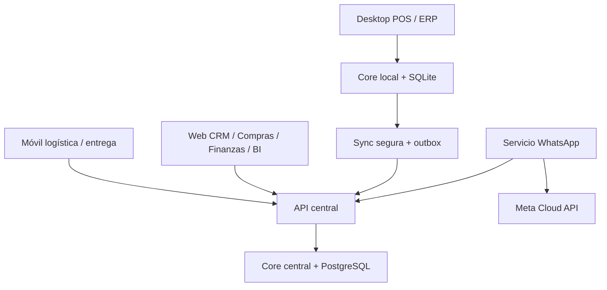

# SPJ ERP/POS — plano maestro desde cero

**Producto objetivo:** plataforma ERP/POS modular, multiempresa preparada, multi sucursal, multi almacén, escritorio y web, para comercio de abarrotes y procesamiento/venta de proteínas. **Referencia técnica:** rama `claude/erp-financial-bounded-context-uqxz6b` en la fecha del [índice](README.md). La implementación existente es insumo de descubrimiento, no una restricción para perpetuar sus duplicidades. Consultar [benchmark](BENCHMARK.md).

## Decisiones de arquitectura que gobiernan todo el producto

| Decisión | Contrato |
| --- | --- |
| Fuente única | Cada maestro, ledger y agregado tiene dueño; otras áreas usan ID/evento/API, no tablas espejo editables. |
| Core modular | Dominio y aplicación por contexto con UoW por comando; adaptadores de escritorio/web usan el mismo servicio. WhatsApp tiene proceso y ciclo de vida propios. |
| Persistencia | SQLite local por instalación/sucursal para caja y operación offline; servicio central con PostgreSQL para web, colaboración y consolidación. No compartir archivo SQLite por red. |
| Sincronización | Outbox/inbox durables, operaciones UUIDv7, versiones, causalidad, reintentos y conflictos observables; autoridad central para saldo global/cupón único; límites offline por sucursal. |
| Identidad | UUIDv7 interno, folio humano por documento/serie/sucursal y códigos de barras/QR con tokens verificables según uso. Nunca UUID completo visible al cliente. |
| Seguridad | IdP/sesión canónica; RBAC+alcance sucursal/almacén+segregación; secretos cifrados y auditoría de configuración; no crear un RBAC web paralelo. |
| Exactitud | Decimal, unidades y conversiones versionadas, captura de peso estable, impuestos/costos por reglas versionadas. |
| Eventos | Outbox transaccional por dueño, consumidor idempotente, DLQ y conciliador de pendientes; evento no sustituye una respuesta transaccional. |
| UX | Un design system común con adaptadores PyQt y web; términos, estados y búsqueda iguales; permisos y feature flags determinan navegación. |
| Despliegue | Instalador Windows por perfil y actualizador con backup/self-test/rollback; API y web central versionadas independientemente; WhatsApp remoto o servicio Windows opcional. |

## Topología

La elección de PostgreSQL central es **propuesta**; el repositorio actual opera principalmente con SQLite. Sin el servicio central, las web apps se limitan a una instalación controlada y no pueden prometer multi sucursal en tiempo real.

## Catálogo de módulos y dependencia funcional

| Grupo | Módulos incluidos | Trabajo central y dueño del dato |
| --- | --- | --- |
| Plataforma | Identidad, usuarios, roles, sesiones, sucursales, instalaciones, almacenes, configuración, flags, auditoría, integraciones, API keys, monitoreo, distribución/actualización | Scope, políticas, credenciales, disponibilidad. |
| Catálogo | Productos, categorías, variantes, marcas, unidades, impuestos, códigos, imágenes, proveedores, listas y costos/precios | Product master y price list versionados. |
| Abastecimiento | Forecast/reabasto, requisiciones, RFQ, comparativos, órdenes, compra directa, recepción, facturas proveedor, devoluciones | Documento comercial, aprobación y conciliación. |
| Movimiento | Logística, tipos/contenedores, viaje, jerarquías, sello, transporte, cadena fría, transferencias, inventario, conteos, ubicaciones | Custodia logística separada del ledger de stock. |
| Planta | Producción cárnica multiproteína, recetas, perfiles rendimiento, despiece, calidad, merma, retrabajo, empaque, genealogía y costing | Transformación física y costo de salida. |
| Comercio | CRM/cliente 360, leads, actividades, cotizaciones, pedidos, POS, ventas a crédito, delivery, devoluciones, promociones | Ciclo cliente, venta, entrega y reversión. |
| Valor cliente | Fidelidad, tarjetas, puntos, recompensas, vales, cupones, campañas, referidos y sorteos | Saldos, elegibilidad y pasivo con protección de margen. |
| Control | Caja, tesorería, CxP/CxC, contabilidad, conciliación, presupuestos, activos fijos, RR. HH., nómina | Ledgers monetarios y personas. |
| Información | BI/analítica, alertas, escenarios, reportes, proyecciones | Métricas certificadas, nunca fuente de mutación. |
| Canales | Tickets/etiquetas, hardware (báscula/lector/impresora/cajón/terminal), WhatsApp, notificaciones, pantalla cliente | Salida física y comunicación; no asumir propiedad de ventas. |

Cada fila del [catálogo detallado](MODULE_CATALOG.md) tiene flujos, invariantes y canales. Los módulos de web son experiencias sobre estos mismos dueños, no contextos nuevos.

## Casos de uso transversales

1. **Origen a venta:** OC/directa → carga/custodia → recepción/calidad → stock → despiece por rendimiento real → venta de cortes o bundle → pago/caja → finanzas/BI.
2. **Reabasto:** forecast sugiere → comprador aprueba → proveedor confirma → almacén recibe → costo y existencias → diferencias/CxP.
3. **Cliente omnicanal:** lead por web/WhatsApp → consentimiento e identidad → oportunidad/cotización → pedido/POS/entrega → CxC y fidelidad → servicio/devolución.
4. **Transferencia:** autorización → reserva origen → carga y custodia → recepción ciega destino → diferencias → ledger en dos almacenes → costo conservado.
5. **Cierre:** turno/caja → pagos/devoluciones → conteo ciego → corte Z → custodia/depósito → conciliación bancaria/asientos → dashboards.

Ver estados, errores y compensaciones en [Appflow](APPFLOW.md). Ninguna pantalla puede marcar «completado» sólo por emitir un evento.

## No funcionales y definición de listo

- Versiones públicas de API y payload; pruebas de compatibilidad hacia atrás o migración conjunta; OpenAPI para web y contratos de eventos.
- Objetivo de UX: búsqueda local ≤300 ms p95 en catálogo representativo; flujo POS con escáner y teclado sin mouse; KPI y reportes paginados con filtros por scope. Estas son **metas**, sujetas a pruebas de carga.
- Seguridad: TLS para remoto; secretos en almacén seguro, rotación, mínimo privilegio, MFA en web administrativa, CSRF/CORS y protección de sesiones; trazas sin PII/secretos.
- RPO/RTO definidos por instalación antes de producción; backup probado por restauración, monitoreo y alertas de outbox, DB, servicio WhatsApp y sincronización.
- Estado de una fase «terminado» sólo con transacción, permisos, UI, pruebas de negativo/idempotencia, migración limpia, manual y observabilidad. El [plan de entrega](DELIVERY_PLAN.md) fija puertas verificables.

## Referencias al código actual

`backend/domain/` y `backend/application/` incluyen los contextos del catálogo; `frontend/desktop/modules/` cubre POS/administración; `frontend/web/` sólo contiene logística/delivery; `backend/api/main.py` sólo incorpora rutas móviles/analytics; `whatsapp_service/` está en la raíz externa del paquete; `installer/windows/` cubre escritorio y un servicio WhatsApp opcional. Estas rutas muestran el punto de partida, no certifican cobertura ni integración del plano maestro.
