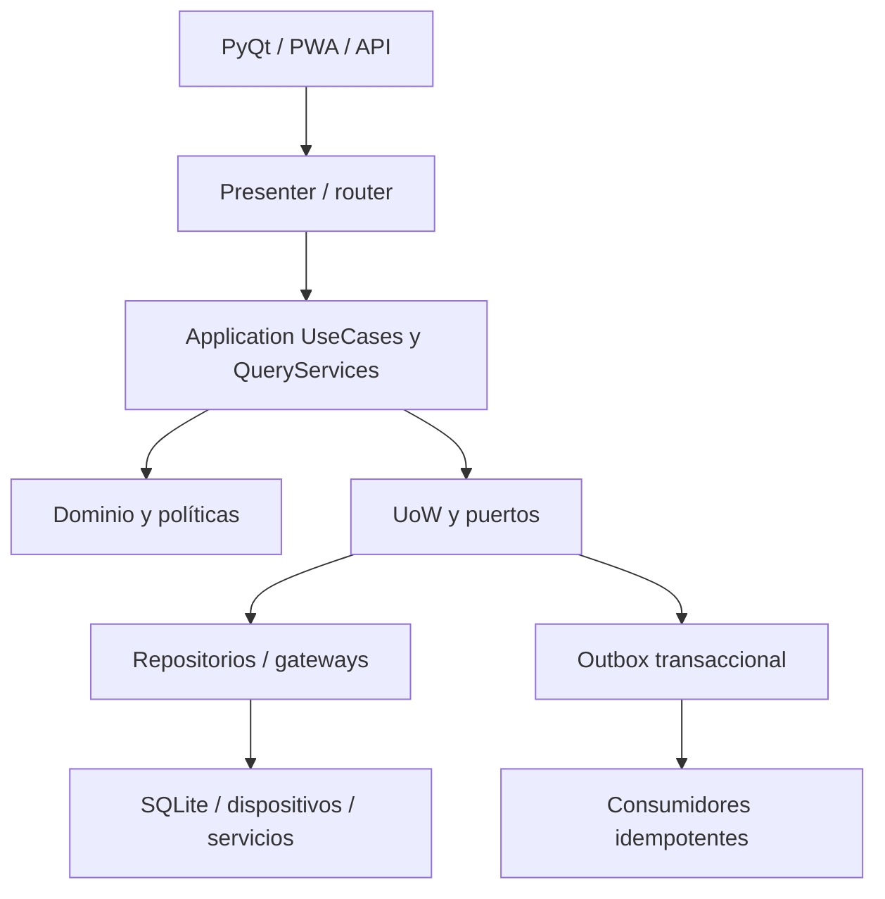

# TRD — Arquitectura técnica de la plataforma

**Contrato objetivo desde cero.** Ver [plano maestro](MASTER_BLUEPRINT.md), [web](WEB_APPS.md) y [servicio WhatsApp](WHATSAPP_SERVICE.md). La sección de línea base permite rastrear qué partes existen; el resto es especificación de construcción.

## 1. Línea base comprobada

Rama `claude/erp-financial-bounded-context-uqxz6b`, commit `32cfbf278e9fdc600ae8953be842626a455c3b4a`. Escritorio PyQt5; SQLite y migraciones Python/SQL; API FastAPI parcial; frontend web para logística/entregas; empaquetado Windows PyInstaller/Inno Setup. El arranque de escritorio está en `frontend/desktop/app.py`; la composición en `backend/bootstrap/`; eventos cruzados en `backend/bootstrap/wiring/event_wiring.py`. Los directorios `backend/domain`, `backend/application` e `backend/infrastructure` son extensos; las convenciones de capas son objetivo que se debe verificar en cada caso de uso, no una propiedad garantizada de todo el código.

## 2. Modelo de ejecución

Comandos llevan `operation_id` UUIDv7, actor, sucursal/instalación/almacén según caso, versión esperada y causalidad. Lecturas entregan DTOs paginados a la UI. Los repositorios no deciden autorización, la UI no ejecuta SQL y la API comparte caso de uso con escritorio.

## 3. Fronteras y contratos

| Contexto | Escribe | Lee referencias de | Evento contractual deseado |
| --- | --- | --- | --- |
| Catálogo/Precios | productos, receta/rendimiento y listas versionadas | categorías, sucursales | `PRODUCT_UPDATED`, `PRODUCT_PRICE_CHANGED` |
| Compras | OC, compra directa, recepción, factura proveedor | producto, proveedor, sucursal | compra confirmada, recepción aceptada/revertida |
| Logística | contenedores, embarques, unidades y custodia | OC/compra directa, lotes, ubicación | despacho/llegada/custodia |
| Inventario | ledger, balance, lote, reserva, cuarentena | producto, recepción, producción, venta | ingreso/consumo/reserva/liberación |
| Producción | orden, consumo, salidas, rendimiento, genealogía | lote, receta, costo | producción completada/desviación |
| Ventas/POS | venta, líneas, asignación de cliente y pagos referenciados | disponibilidad, precio, beneficios | venta completada/devuelta |
| Caja | turno, cobros, retiros, cortes y entrega | venta y medio de pago | movimiento/corte/entrega |
| Finanzas | CxP, CxC, diario, tesorería | documentos comerciales y eventos | asiento/reconciliación |
| Fidelidad/CRM | cuenta cliente, puntos, beneficios | cliente, venta | acumulación/canje/reversión |
| RR. HH. | empleado, asistencia, nómina | usuario/sucursal/caja | nómina pagada |

No confiar en un nombre de evento de esta tabla sin cotejarlo con `backend/shared/events/event_names.py` y su payload real; es contrato objetivo.

## 4. Transacciones y entrega de eventos

1. Autorizar antes de mutar. Validar `session`, scope, permiso granular y perfil instalado/feature flag.
2. Abrir UoW; aplicar precondiciones de estado y versión; guardar agregado, ledger/auditoría y outbox en la misma transacción.
3. Confirmar una sola vez; despachar después; consumidor inserta `processed_event(event_id, consumer)` bajo UNIQUE, y sólo entonces aplica el efecto.
4. Para operaciones entre contextos sin transacción compartida, usar estado pendiente y compensación explícita; no declarar inventario/finanzas terminados hasta confirmar sus proyecciones.
5. Reintento del mismo `operation_id` devuelve resultado previo. Reintento con distinto contenido rechaza conflicto. Dinero/peso con `Decimal`, SQLite `TEXT` normalizado.

**Brechas observadas:** `backend/bootstrap/wiring/event_wiring.py` cablea procurement, sales, customers, cash, pricing, costing, quality y HR, pero deja logística fuera expresamente por secreto de firma QR no aprovisionado. `backend/api/main.py::create_app()` registra routers y PWA, sin construir allí los servicios de sesión y origen necesarios para el flujo móvil. Antes de prometer logística/PWA integrada, agregar wiring/configuración real y prueba de arranque. El mismo archivo advierte una posible doble entrada de inventario si se conecta el cutover `CanonicalInventoryCutover` junto al puente canónico de recepción.

## 5. Identidad, permisos y seguridad

- Generador común `backend/shared/ids.py`; UUIDv7 para identidades internas, folio comercial separado y legible. No mostrar UUID en caja/tickets.
- Vocabulario derivado de `backend/application/<context>/permissions.py` hacia `backend/application/security/permission_catalog.py`. La tabla de usuario/rol/sucursal debe resolverse en un evaluador backend con denegación predeterminada y prueba por acción.
- Deuda real en catálogo: `losses`, `suppliers`, `transfers` aún tienen permisos planos; módulos de menú `FINANZAS` y `CLIENTES_CRM` divergen de sembrados `FINANZAS_UNIFICADAS` y `CLIENTES`. Consolidar mediante migración del vocabulario y tests; no crear otro checker.
- Credenciales QR: token firmado/opaco, revocable; no serializar contenido, precio ni datos personales en QR. Secrets por instalación fuera de repositorio y de tickets/logs. API móvil: autenticación, alcance, idempotencia, rate limit y rechazo de operaciones offline obsoletas.
- Separación de funciones: quien aprueba su propia excepción, despacha y recibe, o registra y cierra pérdida no debe recibir automáticamente esa autorización.

## 6. Offline y consistencia

La estación almacena operaciones locales y cursor de sincronización. Cada comando móvil contiene `client_operation_id`, `device_id`, `session_id`, `payload_version`, `expected_version` y hora del dispositivo; el servidor registra hora de recepción. Mostrar `PENDIENTE`, `CONFIRMADO` y `CONFLICTO`. Reconciliar saldos, stock, sellos, custodia y pagos mediante compare-and-set; nunca last-write-wins para estos hechos. Definir límites de operación sin red y un modo de bloqueo cuando no se pueda validar cupón/vale de uso único entre estaciones.

## 7. Instalador y operación

`installer/windows/spj.spec` empaqueta aplicación; `installer/windows/spj_setup.iss` define componentes; `backend/domain/software_distribution/install_profile.py` define capacidades por estación. El catálogo actual no tiene `logistics` independiente y asigna la familia `LOGISTICA` a `orders_delivery`. Registrar logística sólo cuando exista módulo de escritorio funcional y resolver su dependencia con compras/inventario; entonces actualizar perfiles, instalador, rutas, permisos, migración y pruebas en Windows limpio. La API móvil necesita proceso hospedado, configuración y arranque verificables. Actualización: firmar/validar paquete, cerrar instancias, respaldo de SQLite, aplicar migraciones, self-test, revertir si falla, conservar logs.

## 8. Atributos de calidad y pruebas

| Propiedad | Prueba de aceptación |
| --- | --- |
| Integridad | Dos reintentos de recepción/venta/producción generan un único ledger y un único efecto financiero. |
| Seguridad | Sin sesión, permiso, sucursal o capability la operación falla desde UseCase/API. |
| Exactitud | `Decimal` de punta a punta para importe, peso, rendimiento y costo; balance de asientos 0. |
| Disponibilidad | Cortes de red no generan confirmación ficticia; reintento idempotente y conflicto visible. |
| Observabilidad | Correlation/operation/event IDs en log técnico, folios comerciales en UI y tickets. |
| Instalación | Windows limpio sin Python, perfil POS y perfil completo, backup/update/rollback probados. |

**Fuentes revisadas:** `frontend/desktop/app.py`, `backend/bootstrap/wiring/event_wiring.py`, `backend/api/main.py`, `backend/application/security/permission_catalog.py`, `backend/domain/software_distribution/install_profile.py`, `backend/application/logistics/wiring.py`, `backend/application/event_handlers/inventory/purchase_stock_entry_bridge.py`, `migrations/standalone/171_logistics_bounded_context_schema.py`.

## 9. Núcleo central y sincronización propuestos

**Aislamiento:** un servicio API central despliega casos de uso y repositorios sobre PostgreSQL; estaciones mantienen SQLite local para POS y operaciones autorizadas sin red. Central es autoridad sobre identidad, catálogo maestro, campañas, folios compartidos, límites financieros globales, cupones únicos y cierre consolidado. La estación es autoridad temporal sobre su turno y sus movimientos locales dentro de cupos explícitos. La publicación sincronizada no aplica una mutación por segunda vez: el servicio central reconoce `installation_id + operation_id`, valida versión y devuelve ACK/rechazo/conflicto. Una venta local confirmada se etiqueta «pendiente central» hasta ACK, pero conserva integridad local y recibo con folio local único.

La sincronización incluye snapshot inicial, cursor durable por stream/contexto, reintento ordenado cuando existe causalidad, auditoría de reloj, reconciliación por hashes/conteos de ledger y «último sincronizado» visible. Cambios de precio: vigencia y versión aplicada al checkout; conflicto de stock entre sucursales no se resuelve sumando proyecciones; transferencias usan estados de tránsito/recepción. Si se opera sólo en una sucursal, puede iniciarse con una única instalación y API local; el contrato central permanece estable.

## 10. Contratos HTTP por área

| Área | Consultas/Comandos públicos propuestos | Requisitos adicionales |
| --- | --- | --- |
| CRM | `/api/v1/customers`, `/leads`, `/opportunities`, `/activities`, `/quotes` | Pagination, consentimiento, PII/branch scope. |
| Compras | `/api/v1/purchase-orders`, `/direct-purchases`, `/receipts`, `/supplier-invoices` | Workflow de aprobación, idempotencia, expected_version. |
| Inventario/logística | `/api/v1/stock/availability`, `/lots`, `/shipments`, `/containers`, `/custody` | Scopes almacén, offset/cursor y comandos offline. |
| Producción | `/api/v1/processing/orders`, `/execute`, `/outputs`, `/yield` | Balance masa, perfil snapshot y permisos de override. |
| Ventas/caja | `/api/v1/sales`, `/payments`, `/cash-shifts`, `/cuts` | JWT/sesión, cash scope, idempotencia, no datos tarjeta sensibles. |
| Finanzas | `/api/v1/journals`, `/payables`, `/receivables`, `/reconciliations` | Segregación, periodo abierto y auditoría exportación. |
| BI | `/api/v1/metrics/{metric}`, `/dimensions`, `/drilldowns` | RLS, watermark, límite de filas, métrica/version. |
| Integraciones | `/api/v1/integrations/whatsapp/config`, `/status`, `/templates` | Secret reference, prueba, rotación, permisos de operación. |

Ejemplo de comando (estructura; sin fijar librería): `POST .../purchase-orders`, cabecera `Idempotency-Key: <uuidv7>`, cuerpo `{branch_id, supplier_id, lines:[{product_id, quantity:"12.500", unit_id, unit_price:"42.30"}], expected_version:0}`. Respuesta `{id, folio, status, version, operation_id}`. Errores estructurados `code`, `message`, `field_errors`, `correlation_id`, `retryable`; nunca exponer stack/secret. Mutaciones producen 409 en versión/duplicado incompatible, 403 en scope y 422 en invariantes. No usar `Idempotency-Key` como credencial.

## 11. Catálogo mínimo de eventos y responsabilidad

| Productor | Hechos | Consumidores con efecto |
| --- | --- | --- |
| Compras | PurchaseConfirmed, GoodsReceiptAccepted, GoodsReceiptReversed | Inventario, Finanzas, Logística, BI. |
| Logística | ShipmentDispatched, ShipmentArrived, CustodyTransferred, TemperatureObserved | Compras/Transferencias, Calidad, BI; no stock directo. |
| Inventario | StockReceived, StockReserved, StockConsumed, StockReleased, StockAdjusted | Producción, Ventas, Costos, BI. |
| Producción | ProductionCompleted, YieldVarianceDetected, OutputReleased | Inventario, Costos, Calidad, BI. |
| Ventas | SaleCompleted, SaleReturned, PaymentConfirmed | Inventario, Caja, Finanzas, Fidelidad, BI. |
| Caja | ShiftClosed, CashHandoverConfirmed, DifferenceRaised | Finanzas, RR. HH. y alertas. |
| Fidelidad | PointsIssued, VoucherRedeemed, CouponConsumed, BenefitReversed | Finanzas, POS proyecciones, CRM. |
| RR. HH. | PayrollPaid | Finanzas, BI agregado. |
| WhatsApp | MessageReceived, DeliveryStatusChanged, HandoffRequested, OrderDraftConfirmed | CRM, Ventas/Pedidos, analítica. |

Los nombres son **propuestos** y se mapean una sola vez a los eventos actuales. Envelope `{event_id, event_type, schema_version, aggregate_type, aggregate_id, aggregate_version, operation_id, correlation_id, causation_id, branch_id, occurred_at, payload}`; consumidor declara clave única `(consumer,event_id)` y política de reintentos. Rechazar evento futuro incompatible con DLQ visible.

## 12. Protección y cumplimiento operativos

Documentar amenaza por interfaz: pérdida de dispositivo, acceso a SQLite, escalamiento de rol, IDOR web, replay de webhook Meta, inyección en mensaje/plantilla, exposición de PII en log/BI, doble canje, overbooking stock y actualización maliciosa. Usar cifrado en transporte, hardening de dispositivo, mínimo privilegio DB, respaldo cifrado, auditoría append-only con retención y exportación controlada. Los datos fiscales, laborales y sanitarios requieren revisión local antes de fijar defaults. En WebSocket/notificación push también filtrar scope. APIs Meta/versiones de librerías se revisan al integrar.
