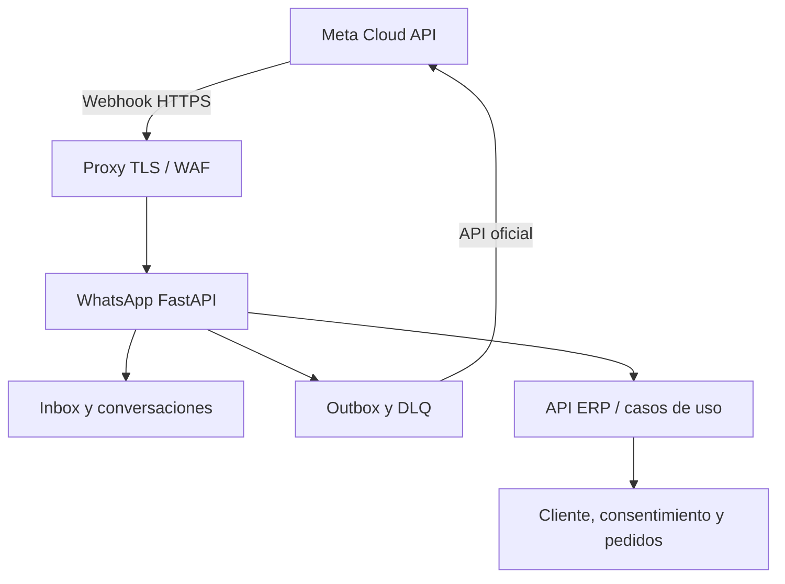

# Microservicio WhatsApp — producto y arquitectura

## 1. Responsabilidad

Un canal de comunicación oficial de Meta para conversaciones, cotizaciones/pedidos, notificaciones transaccionales y campañas consentidas. El microservicio **posee** números, webhooks, conversaciones, mensajes, entregas, plantillas operativas, bandeja, outbox y métricas del canal. CRM posee cliente y consentimiento maestro; Compras/Ventas poseen documentos; Delivery entrega; Finanzas pagos. El servicio sólo pide comandos autorizados a la API ERP y conserva referencias/estados, nunca escribe tablas de ventas/inventario directamente.

**Referencia existente:** `whatsapp_service/` en raíz, `service_host.py`, FastAPI en `main.py`, esquemas `backend/infrastructure/db/schema/whatsapp_schema.py`, instalador opcional `spj_whatsapp.exe`. Estos elementos necesitan auditoría de arranque/wiring y convergencia de datos: el esquema canónico registra tablas nuevas, pero su propio código indica que hay rutas históricas aún activas. No diseñar una tercera bandeja ni otro sender.

## 2. Topología y despliegue

**Modo recomendado:** servicio remoto siempre disponible, DB propia o esquema controlado en PostgreSQL central, acceso ERP por API autenticada, nunca archivo SQLite compartido por red. **Modo local opcional:** Windows Service en una sola estación con `spj_whatsapp.exe`, loopback por defecto; para webhooks públicos se requiere proxy HTTPS accesible y configuración explícita. Instalador no debe ofrecer un servicio local que no pueda recibir webhooks en ese entorno. Secretos/config de cada modo separables y diagnosticables.

## 3. Configuración administrable

| Sección UI | Campos/acción | Comportamiento |
| --- | --- | --- |
| Conexión Meta | WABA ID, phone number ID, versión API, número, estado | Validar acceso y permisos, no mostrar token completo. |
| Webhook | URL pública, verify token, firma/app secret, suscripciones | Asistente de verificación y prueba firmada; registrar último evento y error. |
| Autenticación ERP | URL API, credencial service-to-service, certificados, scope | Prueba de salud/sesión y rotación con auditoría. |
| DB y host | DSN por secret reference, esquema, TLS, migración, bind/puerto | Diagnóstico de conectividad con permisos mínimos. |
| Números/sucursales | Mapeo, horario, idioma, responsable de handoff | No suponer una sucursal si el número atiende varias. |
| Plantillas | Categoría, idioma, estado aprobación, variables, versión | Preview y pruebas; validación de plantilla aprobada. |
| Envíos | Consentimiento, supresión, presupuesto, cola, límites y reintentos | Aprobación antes de campaña; transaccional según política. |
| Servicio | Estado proceso, versión, última conexión, iniciar/detener/reiniciar si está instalado local | Web remoto sólo muestra estado y acciones autorizadas del orquestador. |

Guardar referencias a secretos, nunca claves en respuesta de lectura; enmascarar, rotar, revocar y registrar actor. «Sin configurar» distingue campo faltante, secreto inaccesible, número inválido, webhook fallido, DB desconectada y servicio detenido.

## 4. Flujos y límites

1. **Webhook:** verificar challenge; validar firma del cuerpo crudo y tamaño; registrar evento proveedor por ID único; responder pronto; procesar asíncronamente. Reintento duplicado es no-op y conserva resultado.
2. **Identidad:** normalizar E.164, vincular cliente sólo tras regla de verificación; desconocido se registra como contacto provisional. Mantener historial y consentimiento por canal/finalidad.
3. **Conversación:** mensaje entrante → clasificación determinista y posible IA con baja confianza → agente/flujo; comandos de catálogo/pedido consultan API ERP y muestran disponibilidad/costo de entrega con marca temporal.
4. **Borrador comercial:** cotización o pedido propuesto requiere confirmación de cliente y autorización ERP; confirmación crea una sola orden, nunca reserva/pago por una frase ambigua.
5. **Notificación:** evento de ERP → política consentimiento/plantilla → outbox → proveedor → estados aceptado/enviado/entregado/leído/error; retry con backoff y DLQ. La aceptación de API externa no equivale a entrega.
6. **Handoff:** bandeja compartida con propietario, SLA, resumen, respuesta manual, cierre y devolución a automatización; ninguna IA envía datos de terceros sin autorización.

## 5. Métricas y operaciones

Dashboard: mensajes entrantes/salientes por número/sucursal, entregados y fallidos, latencia webhook, cola/reintentos/DLQ, primer tiempo respuesta, handoff, conversaciones resueltas, cotizaciones convertidas, pedidos confirmados, costo de mensajes según datos del proveedor, consentimiento/rechazos. Filtros por rango, número, sucursal y plantilla; denominador definido y datos sensibles agregados. Alertar si webhook deja de llegar, secretos expiran, respuestas 401/429, backlog o caída de DB/API.

Pruebas: firma inválida, challenge, duplicados, número desconocido, secreto rotado, token caído, API ERP caída, reintentos/429, plantilla rechazada, falta consentimiento, servicio local desinstalado, recuperación tras actualización. Referencia oficial: [Meta Developer Hub](https://whatsappbusiness.com/developers/developer-hub/), [webhooks de Meta](https://www.postman.com/meta/whatsapp-business-platform/folder/tduohwq/webhook-payload-reference) y [plantillas](https://www.facebookblueprint.com/student/path/253055-message-templates).
