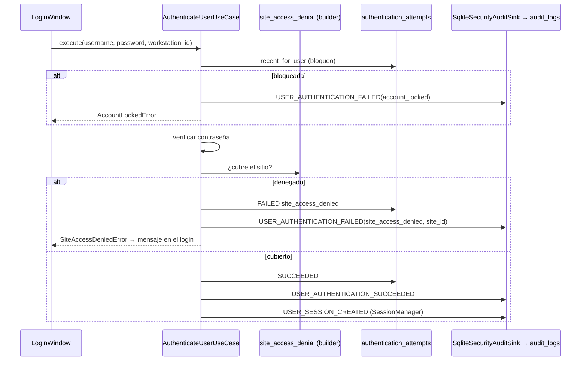

# SDLC-ARQ-AUD-001 — Especificación

- **Intent:** `items/SDLC-ARQ-AUD-001/intent.md` (aprobado el 2026-10-29)
- **Nivel:** T0
- **Estado:** aprovado (2026-10-29, Alfred)

Rutas relativas a `pos_spj_v13.4/`. Todo lo citado con ruta:línea se leyó en esta etapa (2026-10-29, rama `sdlc/sdlc-wa-002`, HEAD `b0279206`).

## Situación actual (evidencia)

1. **Login de escritorio sin sink.** `AuthenticateUserUseCase` cae en un sink no-op (`backend/security/authentication/authenticate_user_use_case.py:71`) y la composición de producción no le pasa ninguno (`frontend/desktop/shell/desktop_shell_authentication_composition.py:100-108`). Lo mismo para `SessionManager` (`:85`), `AccountRecoveryService` (`:109-112`) y `ProvisionInstallationUseCase` (`:88-94`). Hoy sólo queda la fila de `authentication_attempts`.
2. **Verificación de autorizador y login móvil sin sink.** `build_authorizer_credentials_verifier()` (`backend/security/authentication/verify_authorizer_credentials_use_case.py:99-112`) no pasa `audit_sink`. Esta fábrica la usan Caja (`backend/infrastructure/desktop/cash_register_factory.py:1273`), Cárnico (`meat_processing_factory.py:468`), Transferencias (`transfers_factory.py:54`), Fidelidad (`frontend/desktop/modules/fidelidad/composition.py:119`), POS (`frontend/desktop/modules/sales_pos/composition.py:314`) y el login móvil (`backend/api/mobile_credentials.py:36`).
3. **Denegación por sitio cuenta como éxito.** El caso de uso registra `SUCCEEDED` y abre la sesión (`authenticate_user_use_case.py:104-112`). La regla de sitio se evalúa después, en `ApplicationContextBuilder.build()` (`backend/bootstrap/application_context_builder.py:81-83`). El coordinador captura `SiteAccessDeniedError`, revoca la sesión y vuelve al login (`frontend/desktop/auth/authentication_coordinator.py:89-98`). La denegación no deja registro de fallo.
4. **La terminal no se registra.** `app.py:518` llama a `build_authentication_coordinator()` sin `workstation_id`, y el valor por defecto es `""` (`desktop_shell_authentication_composition.py:79`). Por eso `authentication_attempts.workstation_id` queda vacío en producción. El contexto ya usa el hostname como respaldo (`backend/bootstrap/application_context.py:43-47`, `application_context_builder.py:112`).
5. **Intento durante el bloqueo, invisible.** `require_not_locked_out` lanza `AccountLockedError` (`authenticate_user_use_case.py:87-89`) antes de que se registre o audite nada.
6. **Cambio de sucursal.** `ApplicationContextService.change_branch()` emite eventos (`backend/bootstrap/application_context_service.py:85-125`), pero sus cuatro rechazos lanzan la excepción sin emitir ningún evento de denegación. Además **nada en producción construye `ApplicationContextService`**: el barrido de `backend/`, `frontend/` y `main.py` sólo encontró menciones en docstrings. No existe la acción «Cambiar sucursal» (SDLC-UI-016).
7. **Ya existe destino persistente.** `audit_logs` (`migrations/m000_base_schema.py:2386-2399`, índices en `migrations/standalone/048_v131_hardening.py:86-89`) y su escritor `SqliteAuditLogRepository.record()` (`backend/infrastructure/db/repositories/settings/audit_log_repository.py:51-84`). Configuración → Auditoría lo lee con `recent()` (`:45-50`).
8. **Commit.** La conexión de la app es autocommit (`backend/infrastructure/db/connection.py:103`, `isolation_level=None`). Cada INSERT del login se confirma de inmediato, aunque el caso de uso termine lanzando una excepción.

## Comportamiento esperado

### Autenticación de escritorio (`AuthenticateUserUseCase`)
| Caso | `authentication_attempts` | Eventos en `audit_logs` | Sesión |
|---|---|---|---|
| Usuario/contraseña vacíos | nada (igual que hoy) | nada | no |
| Cuenta bloqueada (intento durante el bloqueo) | **nada** (registrar alargaría el bloqueo) | `USER_AUTHENTICATION_FAILED` motivo `account_locked` | no |
| Usuario inexistente o inactivo | FAILED `unknown_or_inactive_account` | `USER_AUTHENTICATION_FAILED` (+ `ACCOUNT_LOCKED` si cruza el umbral) | no |
| Contraseña incorrecta | FAILED `invalid_password` | ídem | no |
| Credenciales correctas, **ningún rol cubre el sitio de la estación** | FAILED `site_access_denied` (**neutral** para el bloqueo, ver D2) | `USER_AUTHENTICATION_FAILED` motivo `site_access_denied`, con `site_id` | **no se abre** |
| Credenciales correctas y sitio cubierto | SUCCEEDED | `USER_AUTHENTICATION_SUCCEEDED`, `USER_SESSION_CREATED` | sí |

- El mensaje genérico se mantiene: el usuario inexistente, el inactivo y la contraseña incorrecta se ven igual. La denegación por sitio conserva su mensaje actual con el nombre de la sucursal (`application_context_errors.py:16-18`), que ya hoy revela que las credenciales eran correctas.
- **Carrera.** Si el ancla cambia entre la autenticación y `build()`, el builder sigue lanzando `SiteAccessDeniedError` y el coordinador revoca la sesión, lo que deja `USER_SESSION_REVOKED`. Es una defensa en profundidad y no se elimina.

### Verificación de autorizador y login móvil
- `build_authorizer_credentials_verifier(connection, *, purpose="authorizer")` cablea el sink persistente. `mobile_credentials.py` pasa `purpose="mobile"`.
- Los intentos durante el bloqueo se auditan igual que en el login (motivo `account_locked`, sin fila de intento).
- **Fuera de alcance:** el rechazo móvil por falta de `LOGISTICA.embarque.ver` (`mobile_credentials.py:42`). Pertenece a la API móvil de SDLC-ARQ-AUD-003; se anota allí.

### Sesión
- `USER_SESSION_CREATED`, `USER_SESSION_REVOKED` (cerrar sesión, `frontend/desktop/app.py:308`) y `USER_SESSION_EXPIRED` se persisten.

### Recuperación e instalación
- `ACCOUNT_RECOVERY_REQUESTED`/`COMPLETED` e `INSTALLATION_PROVISIONING_STARTED`/`PROVISIONED` se persisten. Las de instalación se escriben dentro de la transacción de aprovisionamiento: si ésta se revierte, la auditoría se revierte con ella, que es lo correcto.

### Cambio de sucursal
- `change_branch()` emite el evento nuevo `APPLICATION_CONTEXT_SWITCH_DENIED` antes de cada rechazo. Motivos: `missing_permission`, `open_operations`, `branch_not_found`, `site_not_covered`.
- Se persisten `APPLICATION_CONTEXT_CHANGED` y `APPLICATION_CONTEXT_SWITCH_DENIED`. `APPLICATION_CONTEXT_CHANGING` y `NAVIGATION_CONTEXT_REBUILT` no se persisten (son señales de navegación, no hechos de seguridad).
- **No hay composición de producción que cablear** (punto 6). Este ítem entrega el evento y el sink probados juntos. El cableado lo hará quien construya el servicio (SDLC-UI-016), con la nota en su intent.

### Bordes
- **Offline:** todo es local (SQLite de la estación). No hay dependencia de red.
- **Reintento:** cada intento es un hecho distinto con su propio `id` UUIDv7. No hay idempotencia que aplicar porque no se reintenta una escritura de auditoría.
- **Concurrencia:** varias estaciones o procesos escriben filas independientes en `audit_logs` (sólo INSERT). `busy_timeout=5000` ya cubre el bloqueo de escritura.
- **Multi-sucursal:** `sucursal_id` es el sitio anclado a la estación en el momento del evento, o el `site_id`/`branch_id` del payload cuando lo trae.
- **Varios usuarios en una máquina (§7):** cada login o logout queda con su propio actor y sesión. No se reutiliza un actor global.
- **Falla al escribir auditoría:** la excepción se propaga y no se traga. Es el mismo modo de falla que ya tiene el INSERT en `authentication_attempts` sobre la misma base. Ver Riesgos.

## Diseño

### Capas afectadas
- `backend/security/` (núcleo de autenticación): caso de uso, política de bloqueo, errores, vocabulario.
- `backend/bootstrap/`: builder (extraer la regla de sitio) y servicio de contexto (evento de denegación).
- `backend/infrastructure/db/repositories/security/`: sink persistente nuevo, delgado, sobre el repositorio existente.
- Composición: `frontend/desktop/shell/desktop_shell_authentication_composition.py` y `frontend/desktop/app.py:518`.
- UI: `frontend/desktop/auth/login_window.py`, sólo una cláusula `except` para mostrar el mensaje de sitio.

### Reutilización (no se crea tabla, repositorio ni servicio de dominio nuevo)
- **Destino:** `audit_logs` vía `SqliteAuditLogRepository.record()`. No se crea `security_event_log`: SDLC-ARQ-AUD-002 existe justamente porque hay ~15 tablas de auditoría, y una más agravaría el problema (ver D1).
- **Vocabulario:** `backend/security/audit/security_events.py`. Sólo se agrega el evento de denegación de cambio de contexto en `backend/bootstrap/application_context_events.py`, junto a sus hermanos.
- **Respaldo de redacción:** `redact_mapping()` de `backend/security/audit/sensitive_data_redaction.py:107`.
- **Regla de sitio:** la misma de `application_context_builder.py:81-83`, extraída a un método que `build()` también llama. No se duplica.
- **Ids:** `new_uuid()` (UUIDv7, `backend/shared/ids.py:54`), ya lo usa el repositorio.

### Contratos

**1. Sink persistente**: `backend/infrastructure/db/repositories/security/security_audit_sink.py`
```python
class SqliteSecurityAuditSink:
    def __init__(self, connection, *, station_site: Callable[[], str | None] | None = None) -> None
    def __call__(self, event: str, payload: dict) -> None   # firma de AuditSink existente
def build_security_audit_sink(connection) -> SqliteSecurityAuditSink
    # station_site = lector del ancla (SqliteInstallationBranchRepository(conn).get()[0])
```
Mapeo a `audit_logs`:

| Columna | Valor |
|---|---|
| `id` | `new_uuid()` (lo pone el repositorio) |
| `accion` | nombre del evento |
| `modulo` | `"SEGURIDAD"` |
| `entidad` | `usuario` (autenticación, bloqueo, recuperación) · `sesion` · `instalacion` · `contexto` (cambio de sucursal) |
| `entidad_id` | `user_id`, `session_id` o `installation_id` según la entidad; `""` si no se conoce |
| `usuario` | `user_id` si se conoce; si no, el `username` tal como se tecleó, truncado a 64 caracteres (D4) |
| `sucursal_id` | `site_id`/`branch_id` del payload; si no hay, `station_site()`; si tampoco, NULL |
| `detalles` | JSON (`ensure_ascii=False`) tras `redact_mapping`: `resultado` (`exito`\|`fallo`), `motivo`, `workstation_id`, `username`, `session_id`, `purpose`, `from_branch_id`, `to_branch_id`, `occurred_at` (ISO-8601 UTC). Las claves ausentes se omiten. |

- `resultado = "fallo"` para `USER_AUTHENTICATION_FAILED`, `ACCOUNT_LOCKED` y `APPLICATION_CONTEXT_SWITCH_DENIED`; `"exito"` para el resto.
- **Eventos no persistidos:** conjunto explícito `{APPLICATION_CONTEXT_CHANGING, NAVIGATION_CONTEXT_REBUILT}`. Cualquier otro evento, incluso uno desconocido, **se persiste**: perder en silencio un evento nuevo es el defecto que este ítem corrige.
- **Lista negra de claves:** antes de escribir, el sink elimina `password`, `new_password`, `raw_token`, `token` y `recovery_code`. Además aplica `redact_mapping` como respaldo.

**2. `AuthenticateUserUseCase`** (`authenticate_user_use_case.py`)
- Nuevo parámetro opcional `site_access_check: Callable[[UserCredentials], SiteDenial | None] | None = None`. Con `None` se comporta como hoy, sin regla de sitio; así los dobles de prueba existentes siguen valiendo.
- Orden nuevo tras verificar la contraseña: rehash (igual que hoy). Luego, si `site_access_check` devuelve una denegación: `_record_failure(..., "site_access_denied")` con `site_id` en el payload, y se lanza `SiteAccessDeniedError(site_name)`. Si no hay denegación, sigue con SUCCEEDED y la sesión, como hoy.
- Ante `AccountLockedError`, se emite `USER_AUTHENTICATION_FAILED {username, reason: "account_locked", workstation_id, occurred_at}` y se relanza la excepción. No se escribe fila de intento.
- Todos los payloads llevan `workstation_id` y `occurred_at`. El de éxito y el de denegación por sitio llevan también `user_id`.
- `SiteDenial` es un dataclass congelado `(site_id: str, site_name: str)` en `backend/security/authentication/errors.py`, junto con `SiteAccessDeniedError`, que se mueve ahí. `backend/bootstrap/application_context_errors.py` lo re-exporta (`from backend.security.authentication.errors import SiteAccessDeniedError`) para que el builder, el coordinador y las pruebas existentes no cambien sus imports. Mover la clase evita que `backend/security` dependa de `backend/bootstrap`.

**3. `ApplicationContextBuilder`**
- `site_access_denial(credentials) -> SiteDenial | None`. Es el cuerpo actual de las líneas 77-83: ancla, resolver y `covers`. `build()` lo llama y lanza el error como hoy.

**4. `AccountLockoutPolicy._trailing_failure_streak`** (D2)
- Los intentos con `failure_reason == "site_access_denied"` se saltan: no cuentan como fallo ni cortan la racha. Se define la constante `NEUTRAL_FAILURE_REASONS = frozenset({"site_access_denied"})` en `account_lockout_policy.py`.

**5. `VerifyAuthorizerCredentialsUseCase` / `build_authorizer_credentials_verifier(connection, *, purpose="authorizer")`**
- La fábrica cablea `build_security_audit_sink(connection)`. El caso de uso usa `purpose` en lugar del literal `"authorizer"` y audita el intento durante el bloqueo, igual que el login.

**6. `ApplicationContextService.change_branch`**
- Antes de cada `raise` se emite `APPLICATION_CONTEXT_SWITCH_DENIED {user_id, from_branch_id, to_branch_id, reason}`.

**7. Composición**
- `build_authentication_coordinator(..., workstation_id: str = "")`: si llega vacío, usa `default_workstation_id()` (D3). Construye un único `audit_sink = build_security_audit_sink(connection)` y lo pasa a `SessionManager`, `AuthenticateUserUseCase` (junto con `site_access_check=ApplicationContextBuilder(connection).site_access_denial`), `AccountRecoveryService` y `ProvisionInstallationUseCase`.
- `LoginWindow._on_login`: agrega `except SiteAccessDeniedError as exc: self._show_error(str(exc)); return`.

### Flujo


## Datos y migraciones
- **Sin migración.** `audit_logs` ya existe con todas las columnas usadas (`m000_base_schema.py:2386-2399`) y tiene índice por `fecha` (`048_v131_hardening.py:86`). `authentication_attempts.failure_reason` ya es texto libre (`backend/infrastructure/db/schema/authentication_schema.py:18`). `site_access_denied` es un valor nuevo, no una columna.
- **Compatibilidad:**
  - Las filas históricas de `authentication_attempts` no cambian.
  - Las filas SUCCEEDED que en realidad fueron denegaciones por sitio quedan como están, porque reescribir historial está prohibido (§12). No hay forma de reconstruirlas.
  - Configuración → Auditoría empieza a mostrar filas `SEGURIDAD` sin cambiar código.
- **Reversa:** revertir el commit. Las filas `SEGURIDAD` escritas quedan como historial válido: no se borran, y nada las lee con un contrato que se rompa.
- **Prueba sobre copia (T0):** aunque no hay migración, el sink escribe en una tabla de la base real. En Build se copia la base real a `%TEMP%` (scratchpad), nunca in situ. Sobre la copia se verifica que `PRAGMA table_info(audit_logs)` contiene las 12 columnas esperadas. Después se ejecuta un login exitoso, uno fallido y uno denegado por sitio con el caso de uso real y el sink real, y se consultan las filas. La salida va en `test-report.md`.

## Seguridad y auditoría
- **Permisos:** ninguno nuevo. Registrar eventos de seguridad no es una acción de usuario y no se condiciona a permisos. Leerlos sigue siendo lo que ya controla Configuración → Auditoría.
- **Validación en backend:** la regla de sitio pasa a evaluarse en el caso de uso de autenticación (backend), antes de abrir la sesión. Hasta ahora la primera reacción a esa regla estaba en el coordinador de UI.
- **Nunca se registran** contraseñas, hashes, tokens de recuperación ni códigos (lista negra más `redact_mapping`). `session_id` sí se registra: es un identificador de sesión en memoria del escritorio, no una credencial presentable. Ver D4 para el `username` de cuentas desconocidas.
- **Qué queda auditado tras el cambio:** login de escritorio (éxito, fallo, bloqueo, intento bloqueado, denegación por sitio), verificación de autorizador (POS, Caja, Transferencias, Cárnico, Fidelidad), login móvil (credenciales), creación, revocación y expiración de sesión, recuperación de cuenta, aprovisionamiento y cambio de sucursal (cuando se cablee).

## Pruebas de regresión antes del cambio (T0)
Se corren **antes** de tocar código. La salida va en `plan.md` como línea base:
- `tests/integration/security/test_authenticate_user_use_case.py` (13): mensaje genérico, bloqueo, rehash, «no filtra la contraseña».
- `tests/integration/security/test_verify_authorizer_credentials.py`
- `tests/unit/security/test_account_lockout_policy.py`
- `tests/integration/bootstrap/test_application_context_builder.py` y `tests/integration/security/test_contextual_permissions.py` (`:188`, `:198`: sitio de la estación y denegación).
- `tests/unit/bootstrap/test_application_context_service.py` (14).
- `tests/ui/test_authentication_coordinator.py` (`:183`, denegación por sitio) y `tests/ui/test_login_window.py`, por archivo. `tests/ui` completo no termina hoy (SDLC-UI).
- `tests/integration/shared/test_audit_trail.py`, `tests/integration/bootstrap/test_composition_root_real_wiring.py` y `tests/integration/shell/test_desktop_startup_reaches_login.py`.

Pruebas nuevas que fijan el comportamiento actual **antes** de extraer la regla:
- **R1:** `site_access_denial` da la misma respuesta que hoy da `build()` en cuatro casos: con ancla cubierta, con ancla no cubierta, sin ancla (sucursal propia) y con resolver sin soporte de ámbitos. Se escriben contra `build()` y luego se duplican contra el método extraído.
- **R2:** racha de bloqueo con motivos mezclados (`invalid_password` × 4 seguido de éxito: sin bloqueo). Fija la semántica de «éxito corta la racha» antes de introducir el motivo neutral.

Única prueba existente que **cambia de expectativa**: `test_only_changing_event_emitted_when_permission_denied` (`tests/unit/bootstrap/test_application_context_service.py:111`). Pasa a esperar `[CHANGING, SWITCH_DENIED]` (D5).

## Criterios de aceptación
Cada uno se prueba contra una BD real de prueba (`tests/integration/_born_clean_db.make_db()`), salvo que se indique otra cosa. Las filas se leen con SQL de `audit_logs`, no con un sink de lista.

1. Un login exitoso con la composición de producción (`build_authentication_coordinator` → `login_window_factory()._authenticate`) deja en `audit_logs` exactamente una fila `USER_AUTHENTICATION_SUCCEEDED` y una `USER_SESSION_CREATED`. Ambas tienen `modulo='SEGURIDAD'`, `usuario=<user_id>`, `detalles.workstation_id` no vacío y `detalles.resultado='exito'`.
2. Contraseña incorrecta: una fila `USER_AUTHENTICATION_FAILED` con `motivo='invalid_password'` y `resultado='fallo'`. Usuario inexistente: igual, con `motivo='unknown_or_inactive_account'` y `usuario` igual al nombre tecleado.
3. Al cruzar el umbral se escribe `ACCOUNT_LOCKED`. Un intento posterior durante el bloqueo escribe `USER_AUTHENTICATION_FAILED motivo='account_locked'`, **no** agrega fila a `authentication_attempts` y no alarga el bloqueo: `locked_until` es idéntico antes y después.
4. Usuario con credenciales correctas sin rol en el sitio anclado: `execute()` lanza `SiteAccessDeniedError` con el nombre de la sucursal. `authentication_attempts` recibe una fila FAILED `site_access_denied` y **ninguna** SUCCEEDED. `audit_logs` recibe `USER_AUTHENTICATION_FAILED` con `motivo='site_access_denied'` y `sucursal_id=<sitio anclado>`. `SessionManager` no contiene sesión para ese usuario.
5. Cinco denegaciones por sitio seguidas no bloquean la cuenta. El mismo usuario puede autenticarse a continuación en una estación cuyo sitio sí cubre su rol.
6. `LoginWindow` muestra el mensaje de sitio en su etiqueta de error y no se acepta (prueba de UI con caso de uso real y BD real; la prueba verifica la etiqueta y `result()`, no sólo que la ventana abra).
7. Cerrar sesión (`coordinator.logout(session_id)`) escribe `USER_SESSION_REVOKED` con ese `session_id` en `detalles`.
8. `build_authorizer_credentials_verifier(conn)` con contraseña incorrecta escribe `USER_AUTHENTICATION_FAILED` con `detalles.purpose='authorizer'`. Con `purpose="mobile"` (desde `DatabaseMobileCredentialVerifier`) escribe `purpose='mobile'`.
9. `change_branch()` con el sink real: cada uno de los 4 rechazos escribe una fila `APPLICATION_CONTEXT_SWITCH_DENIED` con su `motivo`. Un cambio exitoso escribe `APPLICATION_CONTEXT_CHANGED`. No se escriben filas `APPLICATION_CONTEXT_CHANGING` ni `NAVIGATION_CONTEXT_REBUILT`.
10. **Sin secretos:** en todas las filas escritas por los criterios 1-9, `detalles`, `usuario` y `entidad_id` no contienen la contraseña usada, ningún hash de `usuarios`, ni el token de recuperación devuelto por `AccountRecoveryService.begin_recovery()`. La prueba de recuperación cubre `ACCOUNT_RECOVERY_REQUESTED`/`COMPLETED`.
11. Un payload que trae `password`, `token` o `raw_token` (inyectado a mano en el sink) se persiste sin esas claves.
12. Un evento desconocido (`"X_TEST_EVENT"`) se persiste, no se descarta.
13. El aprovisionamiento real (`ProvisionInstallationUseCase` con el sink) deja `INSTALLATION_PROVISIONING_STARTED` e `INSTALLATION_PROVISIONED`. Si el aprovisionamiento falla y se revierte, no queda ninguna de las dos.
14. Arquitectura: `backend/security/**` no importa de `backend/bootstrap/**` (nueva prueba en `tests/architecture/`). `ApplicationContextBuilder.build()` llama a `site_access_denial` (R1 sigue verde).
15. Las pruebas de regresión listadas pasan sin cambios, salvo la indicada en D5. Las rutas de la tabla de Configuración → Auditoría (`SqliteAuditLogRepository.recent()`) devuelven las filas nuevas.
16. Verificación sobre una copia de la base real en `%TEMP%`: columnas de `audit_logs` presentes y los tres escenarios del criterio 1, 2 y 4 producen las filas esperadas. La salida se pega en `test-report.md`.

## Riesgos y alternativas descartadas
- **Falla de escritura bloquea el login.** Si `audit_logs` no puede escribirse, el login falla. Se acepta: comparte base y modo de falla con `authentication_attempts`, que ya está en el mismo camino. Tragarse la excepción reabriría el defecto en silencio. `LoginWindow` no captura excepciones genéricas hoy; no se cambia en este ítem.
- **Volumen.** Son unas 2 filas por login y 1 por logout o verificación de autorizador. La retención es un tema de AUD-002 o de mantenimiento, no de este ítem.
- **Interfaz de `AuthenticateUserUseCase` crece.** El puerto es opcional y los llamadores de prueba no cambian.
- **Descartado: tabla `security_event_log` propia.** Tendría columnas para terminal y resultado, pero sumaría la tabla 16 a la fragmentación que AUD-002 debe converger, y Configuración → Auditoría no la mostraría.
- **Descartado: registrar la denegación en el coordinador** (agregar un FAILED después del SUCCEEDED). Deja la fila SUCCEEDED, que es el defecto, y abre y revoca una sesión que no debió existir.
- **Descartado: publicar en el EventBus.** No hay consumidor de auditoría de seguridad en el bus. El sink directo es síncrono y deja el hecho en la misma base que el intento.

## Decisiones que requieren aprobación

**D1. Destino de los eventos.**
- (a) **`audit_logs` con `modulo='SEGURIDAD'`**: terminal y resultado van en `detalles` JSON hasta que AUD-002 agregue columnas.
- (b) Tabla nueva `security_event_log` con columnas propias (requiere migración y una pantalla para leerla).
- **Recomendación: (a).** No crea fragmentación nueva, se ve hoy en Configuración → Auditoría y AUD-002 migrará `detalles` a columnas.

**D2. ¿La denegación por sitio cuenta para el bloqueo de cuenta?**
- (a) **Neutral:** se registra como fallo, pero no suma a la racha ni la corta.
- (b) Cuenta como fallo: cinco intentos en la caja equivocada bloquean la cuenta 15 minutos en todas las estaciones.
- (c) No se registra en `authentication_attempts`, sólo en `audit_logs`.
- **Recomendación: (a).** La contraseña era correcta, así que no es fuerza bruta, y bloquear al cajero en su propia sucursal sería un efecto injusto. (c) deja el historial de intentos incompleto.

**D3. Identidad de terminal mientras SDLC-ARQ-TERM-001 decide la fuente canónica.**
- (a) **`default_workstation_id()` (hostname)**, el mismo valor que ya usa `ApplicationContext`.
- (b) Dejar vacío hasta TERM-001.
- **Recomendación: (a).** El intent pide «desde qué terminal». TERM-001 sustituirá la fuente en un solo punto, `build_authentication_coordinator`.

**D4. Qué se guarda como actor en fallos de cuentas que no existen.**
- (a) **El nombre tecleado, truncado a 64 caracteres**, igual que ya hace `authentication_attempts.user_reference`.
- (b) Un marcador fijo (`"desconocido"`) con el nombre sólo en `detalles`.
- (c) Nada.
- **Recomendación: (a).** Sirve para detectar enumeración de usuarios y no expone nada que no esté ya en `authentication_attempts`. Riesgo conocido: alguien que teclea su contraseña en el campo de usuario la deja en ambas tablas. Mitigarlo exigiría tratar también `authentication_attempts` y queda fuera de alcance.

**D5. Cambio de sucursal sin cableado de producción.**
- (a) **Agregar `APPLICATION_CONTEXT_SWITCH_DENIED` y probarlo con el sink real ahora.** Esto modifica la prueba `test_only_changing_event_emitted_when_permission_denied`. El cableado queda anotado para SDLC-UI-016.
- (b) Sacar el cambio de sucursal de este ítem y moverlo entero a UI-016.
- **Recomendación: (a).** El intent lo incluye, el cambio es pequeño y deja el contrato listo para cuando exista la acción.
