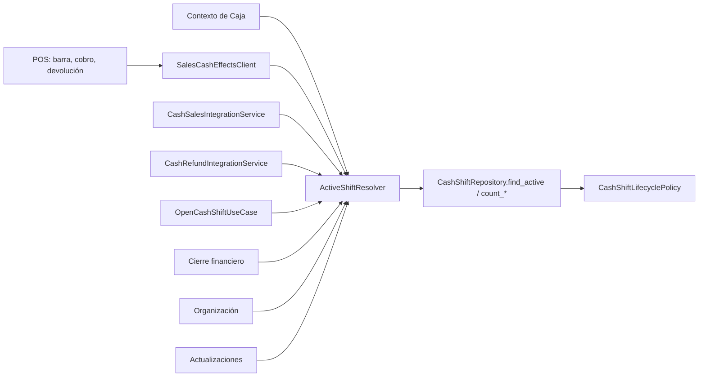

# SDLC-ARQ-SHIFT-001 — Especificación

- **Intent:** `items/SDLC-ARQ-SHIFT-001/intent.md` (aprobado el 2026-10-29, Alfred; pregunta abierta respondida el 2026-11-02 en `BACKLOG.md` → "Decisiones aprobadas")
- **Nivel:** T0 (`cash_register`, `sales`, `finance`, `software_updates`)
- **Estado:** aprobado por autopiloto (2026-11-02) — pendiente de revisión humana en el PR

Rutas relativas a `pos_spj_v13.4/`. Toda ruta:línea se leyó en el commit `1c4786a7`.

## Situación actual (verificada)

| # | Camino | Ruta:línea | Filtro / estados |
|---|---|---|---|
| 1 | `CashShiftRepository.find_open_for_cashier` | `backend/infrastructure/db/repositories/cash_register/repositories.py:63-70` | sucursal + cajero, literal `status='OPEN'`, sin `ORDER BY` |
| 2 | `find_active_for_cashier` | `repositories.py:72-80` | cajero (cualquier sucursal), `ACTIVE_STATUSES`, sin `ORDER BY` |
| 3 | `find_active_for_resource` | `repositories.py:82-92` | caja/cajón/terminal, `ACTIVE_STATUSES` |
| 4 | Venta (cobro) | `backend/application/cash_register/sales_integration.py:91-97,155-158` → camino 1 | sólo `OPEN` |
| 5 | Reembolso | `backend/application/cash_register/refund_integration.py:107-110` → camino 1 | sólo `OPEN` |
| 6 | Apertura | `backend/application/cash_register/shift_use_cases.py:69-80` → caminos 2 y 3 | `ACTIVE_STATUSES` |
| 7 | Contexto de Caja | `backend/infrastructure/desktop/cash_operational_context.py:47-65,116-152,193-229` | SQL propio, `ACTIVE_STATUSES`, sucursal + cajero, con y sin caja (`:122-132`), `ORDER BY opened_at DESC` |
| 8 | Caché en memoria | escrituras en `cash_operational_context.py:63,137` y `backend/infrastructure/desktop/cash_register_factory.py:548`; lectura en `cash_operational_context.py:50-57` | atributo `active_cash_shift_id` del `composition_root` |
| 9 | Cajas ocupadas | `cash_operational_context.py:91-94` | SQL propio, `ACTIVE_STATUSES` |
| 10 | Tres copias de "¿tienes turno?" en el POS | `frontend/desktop/modules/sales_pos/composition.py:128-140`, `backend/application/sales/use_cases/checkout_use_cases.py:201-212`, `backend/application/sales/use_cases/return_use_cases.py:176-186` | todas llaman al camino 1 y redactan su propio mensaje; cualquier `CashRegisterError` u `OperationalError` → "no tienes turno" |
| 11 | Vista general de Caja | `backend/application/cash_register/overview_query_service.py:163,220` | literal `('OPEN','SUSPENDED','CLOSING')` |
| 12 | Listado de turnos | `backend/application/cash_register/shift_query_service.py:95` | literal `{"OPEN","SUSPENDED","CLOSING"}` |
| 13 | Cierre financiero | `backend/infrastructure/integrations/finance_close_sources.py:15-16,66-69` | tupla copiada de los 8 estados activos |
| 14 | Actualizaciones | `backend/infrastructure/db/repositories/software_updates/station_update_repository.py:130,159-162` | tupla copiada de 5 estados "en corte" |
| 15 | Organización | `backend/infrastructure/db/repositories/organization/org_unit_repository.py:144-149` | `NOT IN ('CLOSED','FORCE_CLOSED')` (omite `CANCELLED`, que sí es final en la política) |

Definición canónica: `backend/domain/cash_register/policies/workflow_policies.py:21-35` (`ACTIVE_STATUSES`, `FINAL_STATUSES`). Las únicas transiciones persistidas son `OPEN↔SUSPENDED`, `OPEN→CLOSING`, `CLOSING→CLOSED` (`workflow_policies.py:36-41`, `shift_use_cases.py:143-160`, `repositories.py:94-100`); `CashShift.open` nace `OPEN`. Ningún código escribe `OPENING`, `PENDING_COUNT`, `COUNTING`, `COUNTED`, `PENDING_REVIEW`, `FORCE_CLOSED` ni `CANCELLED` en `cash_shifts` (búsqueda en `backend/`).

Divergencia observable que reproduce el intent: con un turno `SUSPENDED` o `CLOSING`, el contexto de Caja (camino 7) lo devuelve como turno activo y el POS (camino 1) responde "No tienes un turno de caja abierto", aunque la apertura (camino 2) tampoco deja abrir otro. El cajero queda sin poder cobrar y sin saber qué hacer.

La UI (`frontend/desktop/modules/cash_register/cash_register_presenter.py:99-106`, `cash_register_workspace.py:206-207`) ya sólo consume el proveedor del contexto; `cash_shifts_page.py:98-99` usa el renglón **seleccionado** por el usuario como destino explícito de una acción (suspender/reanudar/cerrar un turno concreto) y si no hay selección cae al turno activo del contexto. La selección explícita no es una resolución de "turno activo": el backend valida dueño e intervención (`shift_use_cases.py:117-128`). No se toca.

## Comportamiento esperado

Decisiones de negocio aplicadas (fuente: `BACKLOG.md` → "Decisiones aprobadas"):

- **D-A (2026-11-02, SHIFT-001):** "¿Un turno `SUSPENDED` o `CLOSING` cuenta como activo para vender? → `SUSPENDED` sí, pero debe reanudarse; `CLOSING` no, debe abrir un turno".
- **D-B (2026-11-02, SHIFT-004):** "Turnos incompatibles → por cajero". El turno activo se resuelve **por cajero**.

Reglas:

1. **Turno activo del cajero** = su turno en un estado de `CashShiftLifecyclePolicy.ACTIVE_STATUSES`, en la sucursal pedida. La base ya impide más de uno por cajero, caja, cajón y terminal: índices únicos parciales `ux_cash_shift_active_*` sobre los 8 estados activos (`migrations/standalone/175_cash_register_bounded_context_schema.py:234-237`, verificado: un segundo `OPEN` del mismo cajero lanza `UNIQUE constraint failed: cash_shifts.cashier_user_id`). El resolvedor ordena igual (`opened_at DESC, id DESC`) sólo para ser determinista. Caja, POS, devoluciones y cierre financiero ven **el mismo** turno.
2. **Operabilidad para cobrar o reembolsar** (nueva clasificación en la política de dominio):
   - `OPEN` → operable.
   - `SUSPENDED` → sigue siendo el turno activo del cajero (Caja lo muestra, la apertura de otro sigue bloqueada) pero el POS rechaza con "Tu turno de caja está suspendido. Reanúdalo en Caja antes de cobrar." (D-A).
   - `CLOSING` y los demás estados activos de cierre (`PENDING_COUNT`, `COUNTING`, `COUNTED`, `PENDING_REVIEW`; hoy nunca se escriben) → no operable; el POS responde "Tu turno de caja está en cierre. Termina el cierre en Caja y abre un turno nuevo para cobrar." (D-A: "debe abrir un turno"). `OPENING` (nunca se escribe) se trata igual: no es operable.
   - Sin turno activo → "No tienes un turno de caja abierto. Abre tu turno en Caja antes de cobrar: sin turno, el dinero de la venta no entra a ningún corte." (texto actual de `checkout_use_cases.py:210-211`).
   - Devoluciones en efectivo: mismos tres casos con textos de reembolso (el de "sin turno" es el actual de `return_use_cases.py:185-186`).
3. **Apertura:** sin cambio de regla. Un turno activo del cajero (incluido `SUSPENDED` y `CLOSING`) sigue impidiendo abrir otro, y cualquier turno activo en la caja/cajón/terminal también (`shift_use_cases.py:69-80`). Para "abrir un turno" tras un `CLOSING`, el cajero termina el cierre (`CLOSING→CLOSED`) y luego abre. Cambiar esa regla (incompatibilidad y concurrencia) es alcance de SDLC-ARQ-SHIFT-004.
4. **Recuentos:** "turnos abiertos" para el cierre financiero y para Organización = estados de `ACTIVE_STATUSES` (Organización deja de contar `CANCELLED`; no hay filas `CANCELLED` porque nadie lo escribe). "Cortes en curso" para Actualizaciones = estados de cierre de la política (los mismos 5 de hoy).
5. **Sin caché:** el turno activo se lee de la base en cada consulta; reabrir Caja, reiniciar la app o abrir el turno en otra pantalla da el mismo resultado. Se elimina el atributo `active_cash_shift_id` del `composition_root`.
6. **Fallo de esquema:** se conserva el comportamiento actual de fallar cerrado ante `sqlite3.OperationalError` (base sin esquema de Caja ⇒ no se cobra), pero ahora en un solo lugar. Distinguir la falla de esquema del "sin turno" es SDLC-SALES-007.

Bordes:
- **Multi-sucursal:** el cobro y el reembolso siguen filtrando por la sucursal de la venta (camino 1 hoy). La apertura sigue sin filtro de sucursal (por cajero, D-B).
- **Offline / reintento:** el resolvedor es de sólo lectura sobre SQLite local; no cambia idempotencia de venta/reembolso (`sales_integration.py:159-164`, `refund_integration.py:98-103`).
- **Concurrencia:** el resolvedor corre dentro de la transacción del llamador (misma conexión); no añade bloqueo nuevo. Control de concurrencia de transiciones = SHIFT-004.
- **Permisos:** sin cambio. Quién consulta el turno de otro = SHIFT-002.

## Diseño

Bounded context dueño: Caja (`cash_register`). Capas:

- **Dominio** — `backend/domain/cash_register/policies/workflow_policies.py`:
  - `CashShiftLifecyclePolicy.CLOSING_STATUSES` (= `PENDING_COUNT, COUNTING, COUNTED, PENDING_REVIEW, CLOSING`) y `active_status_values()` / `closing_status_values()` (tuplas ordenadas de `str` para SQL parametrizado).
  - `CashShiftOperability` (enum: `OPERABLE`, `MUST_RESUME`, `MUST_OPEN_NEW`) y `CashShiftLifecyclePolicy.operability(status)`.
  - `backend/domain/cash_register/exceptions.py`: `CashShiftNotOpenError(CashInvalidStateError)` con atributos `shift_id` y `status` (None si no hay turno), y subclases `CashShiftSuspendedError`, `CashShiftClosingError`. Heredan de `CashInvalidStateError`, así todo `except` existente sigue funcionando.
- **Infraestructura** — `CashShiftRepository` (`repositories.py`): un solo método de búsqueda `find_active(*, cashier_user_id=None, branch_id=None, column=None, value=None)` con `ORDER BY opened_at DESC, id DESC LIMIT 1`, más `active_register_ids(branch_id)`, `count_active(*, branch_id=None, business_date_until=None)`. Se eliminan `find_open_for_cashier`, `find_active_for_cashier`, `find_active_for_resource` (sus tres consultas pasan a `find_active`). El repositorio sigue sin `commit/rollback` (`tests/architecture/test_cash_register_unit_of_work_boundary.py`).
- **Aplicación** — nuevo `backend/application/cash_register/active_shift_resolver.py`:
  - `ActiveShift` (DTO inmutable: `id, branch_id, register_id, drawer_id, terminal_id, cashier_user_id, status, opened_at`; propiedad `operability`).
  - `ActiveShiftResolver(connection)`:
    - `for_cashier(*, cashier_user_id, branch_id=None) -> ActiveShift | None`
    - `for_resource(*, column, value) -> ActiveShift | None`
    - `require_operable(*, branch_id, cashier_user_id, purpose="sale"|"refund") -> ActiveShift` — lanza `CashShiftNotOpenError` / `CashShiftSuspendedError` / `CashShiftClosingError` con el texto de la regla 2.
    - `operability_problem(*, branch_id, cashier_user_id, purpose) -> str | None` — el mensaje para el POS; captura `CashRegisterError` y `sqlite3.OperationalError` (regla 6).
    - `busy_register_ids(*, branch_id)`, `count_active(*, branch_id=None, business_date_until=None)`.
  - Se reutiliza `CashRegisterUnitOfWork`/`CashShiftRepository` existente; no se crea tabla ni repositorio paralelo. No se reutiliza `DesktopCashOperationalContextResolver` porque vive en `infrastructure/desktop` y lo necesitan Ventas y Finanzas.
- **Consumidores migrados:**
  - `sales_integration.py` (cobro), `refund_integration.py` (reembolso) → `require_operable`.
  - `shift_use_cases.py` (apertura) → `for_cashier` / `for_resource` (mismos mensajes).
  - `cash_operational_context.py` → `for_cashier` y `busy_register_ids`; sin `setattr` ni lectura de `active_cash_shift_id`.
  - `cash_register_factory.py:548` → se borra la escritura de la caché.
  - `SalesCashEffectsClient` (`backend/infrastructure/integrations/sales_cash_effects_client.py`) gana `open_shift_problem(connection, *, branch_id, cashier_user_id, purpose)`; `composition.py`, `checkout_use_cases.py` y `return_use_cases.py` lo usan en lugar de sus tres copias (sigue siendo el único ACL Ventas→Caja).
  - `overview_query_service.py`, `shift_query_service.py` (read models propios de Caja que listan muchos turnos con JOIN) → placeholders desde `active_status_values()`.
  - `finance_close_sources.py` (adaptador ACL que ya importa de `backend.application.cash_register`, `:25`) → `ActiveShiftResolver.count_active()`.
  - `org_unit_repository.py`, `station_update_repository.py`: son repositorios de infraestructura de otros contextos; para no invertir capas (infraestructura → aplicación) conservan su `COUNT(*)` con su guarda de tabla, pero los estados salen de `CashShiftLifecyclePolicy.active_status_values()` / `closing_status_values()` (dominio). Ninguna tupla copiada.
  - Documentación: docstrings de `frontend/desktop/modules/cash_register/shell_registration.py:16-19,89-92` y su prueba `tests/unit/test_cash_register_shell_registration.py:56-63` dejan de nombrar `active_cash_shift_id` (queda `active_cash_count_id`, fuera de alcance).

## Datos y migraciones
Ninguna. No cambia el esquema de `cash_shifts` ni datos. No se usa el número 355. Reversa: revertir los commits.

## Seguridad y auditoría
Sin permisos nuevos ni cambios de autorización. Los eventos de dominio y el ledger no cambian (mismos `CASH_SALE`, `CASH_REFUND`, `CASH_SHIFT_OPENED`). Las reglas 11-13 de `CLAUDE.md` no se ven afectadas: no hay movimiento de dinero nuevo; se elimina SQL de turno del contexto de escritorio y ninguna UI gana SQL.

## Criterios de aceptación

1. **Coherencia OPEN:** con un turno `OPEN`, el contexto de Caja (`build_cash_register_presenter(...).optional_active_shift_id()`), el POS (`SalesCashEffectsClient().require_open_shift`), el reembolso (`ActiveShiftResolver.require_operable(purpose="refund")`) y el cierre financiero (`SqliteOperationalCloseSources.status().open_cash_shifts == 1`) refieren al mismo id; una venta real en efectivo queda en `cash_ledger_entries` con ese `shift_id`.
2. **Coherencia SUSPENDED:** Caja devuelve el id; el POS rechaza con `CashShiftSuspendedError` cuyo `shift_id` es ese id y su mensaje pide reanudar; el cobro (`record_completed_sale`) no escribe ledger; el cierre financiero lo cuenta; abrir otro turno para ese cajero se rechaza. Tras `ResumeCashShiftUseCase` el cobro funciona sobre el mismo id.
3. **Coherencia CLOSING:** Caja devuelve el id; POS y reembolso rechazan con `CashShiftClosingError` (mismo id, mensaje "abre un turno nuevo"); el cierre financiero lo cuenta; tras cerrarlo (`CLOSED`) nadie lo devuelve y la apertura de un turno nuevo funciona.
4. **Sin turno:** todas las fuentes devuelven `None`/0 y el POS da el texto de "sin turno"; base sin tabla `cash_shifts` ⇒ el POS sigue fallando cerrado.
5. **Sin caché:** tras abrir un turno por el handler de la fábrica, el `composition_root` no tiene `active_cash_shift_id`; cambiar el estado en la base se refleja en la siguiente consulta del contexto sin reconstruir el presentador.
6. **Unicidad en base:** se conserva; no se toca la migración 175. (Criterio original "más reciente gana" retirado: el escenario es imposible por los índices de 175:234-237.)
7. **Recuentos:** `org_unit_repository.open_cash_shifts` y `station_update_repository` (cortes en curso) cuentan los estados de la política (`active_status_values` / `closing_status_values`) y no cuentan `CLOSED`/`CANCELLED`.
8. **Guardia de arquitectura** (`tests/architecture/test_active_shift_single_source.py`): falla si (a) fuera del resolvedor alguien llama a `find_active`/`find_open_for_cashier`/`find_active_for_cashier`/`find_active_for_resource`; (b) aparece `active_cash_shift_id` en `backend/` o `frontend/`; (c) una cadena SQL que menciona `cash_shifts` filtra el estado del turno (`status`/`s.status`, no `c.status` de otra tabla) con literales — `IN ('…')`, `NOT IN ('…')` o `='<estado activo>'` — fuera de `backend/infrastructure/db/repositories/cash_register/repositories.py`; (d) en un archivo de `backend/` o `frontend/` que menciona `cash_shift`, un literal de tupla/lista/conjunto con ≥2 valores de `CashShiftStatus` fuera de `backend/domain/cash_register/`. `migrations/` queda fuera: sus índices son la copia en esquema. El `ORDER BY CASE s.status WHEN 'OPEN' …` de presentación no es un filtro y no se prohíbe.
9. Las suites de Caja, Ventas/POS, Organización, Actualizaciones y Finanzas no tienen fallos nuevos respecto a la línea base de `plan.md`.

## Riesgos y alternativas descartadas
- **Riesgo:** algún consumidor dependía de que `find_open_for_cashier` no ordenara. Mitigación: los índices únicos de 175 garantizan a lo sumo un turno activo por cajero; el orden no cambia resultados.
- **Riesgo:** mensajes de POS distintos para SUSPENDED/CLOSING rompen pruebas que comparan texto. Búsqueda: sólo `tests/unit/test_pos_checkout_dialogs.py:175,184` compara un texto, y lo inyecta con un doble.
- **Descartado:** dejar que el POS acepte `SUSPENDED` y venda sobre él (contradice D-A "debe reanudarse").
- **Descartado:** permitir abrir un turno nuevo con uno `CLOSING` abierto (cambia la regla de incompatibilidad; es SHIFT-004).
- **Descartado:** mover el resolvedor a `infrastructure/desktop` (Ventas y Finanzas no deben depender del escritorio).

## Decisiones que requieren aprobación
Ninguna pendiente: D-A y D-B salen de "Decisiones aprobadas" del backlog. Los textos exactos de los mensajes al cajero son redacción, no regla de negocio; el revisor puede ajustarlos en el PR.
