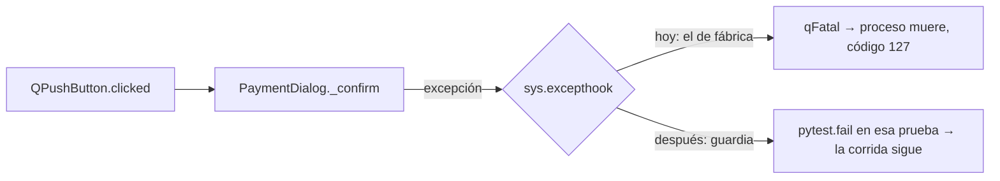

# SDLC-UI-001 — Especificación

- **Intent:** `items/SDLC-UI-001/intent.md` (aprobado el 2026-10-30 por Alfred; preguntas abiertas respondidas: CI corre un **subconjunto marcado** de `tests/ui`; los jobs ventas/ui/api **se eliminan**)
- **Nivel:** T1
- **Estado:** aprobado (2026-10-30, Alfred). D1–D5: las opciones recomendadas — D1 (a) guardia de slots en `tests/conftest.py`; D2 (a) guardia de modales en `tests/ui/conftest.py`; D3 (a) lista de comportamiento/contrato; D4 (a) ampliar SDLC-UI-002; D5 (a) job propio `ui-subset`.

Rutas relativas a `pos_spj_v13.4/` salvo `../.github/…`. *Medido* = salida de un comando ejecutado el 2026-10-30 en esta etapa (Windows 11, Python 3.13.12, PyQt5 5.15.11 / Qt 5.15.2, pytest 9.1.1).

## Diagnóstico (causa del cierre, ya no es hipótesis)

1. *Medido:* la prueba sola, con `-X faulthandler`, `-s` y `PYTHONUNBUFFERED=1`, sigue terminando con código 127 y 0 bytes de salida. Su vecina `test_payment_voucher_keeps_reference_and_rejects_duplicates` pasa (código 0).
2. *Medido:* al reproducir la prueba fuera de pytest con un `sys.excepthook` propio, el hook recibe la excepción y el proceso sigue:
   `payment_dialog.py:358 sale = result.data.get("sale")` → `AttributeError: 'types.SimpleNamespace' object has no attribute 'data'`.
3. Origen: el doble de prueba está desactualizado. `tests/ui/test_operations_standard_dialogs.py:27-29` `_result()` devuelve un `SimpleNamespace` sin `data`. El contrato real, `backend/application/sales/result.py:52-58` `SaleResult`, trae `data: dict` (default `{}`) en todo resultado, y `SalesPosPresenter.record_payment` (`frontend/desktop/modules/sales_pos/sales_pos_presenter.py:408-411`) devuelve `SaleResult`. **El código de producción es correcto; la prueba no lo es.** `payment_dialog.py:358` lee `data` desde `01b58060` (2026-10-19); la prueba se tocó por última vez en `16eb1d8e` (2026-10-28) sin alinearse.
4. Por qué muere el proceso entero: PyQt5 ≥ 5.5 llama a `qFatal()` (abort) cuando una excepción sale de un slot de Qt y `sys.excepthook` es el de fábrica. Pytest no instala uno, así que cualquier excepción en un slot (un `clicked` conectado a `_confirm`) derriba toda la corrida. Lo que no se verificó: por qué Windows reporta exactamente 127 y no imprime nada en stderr.
5. *Medido:* la suite completa con un plugin de sonda que sólo instala un `sys.excepthook` (`-p ui001_hook`, fuera del repo) **llega al resumen**: `107 failed, 1377 passed in 1052.50s (0:17:32)`, 1484 colectadas. Sólo hubo una excepción en un slot en toda la suite: la de esta prueba.
6. Segundo defecto latente en la misma prueba: con el doble ya corregido, `_recorded` pasa a 1 y `_btn_remove.click()` sobre esa fila llama a `_void_recorded` (`payment_dialog.py:294-305`). Ese método abre `CancelSaleDialog(...).exec_()`, un modal real que **colgaría** la corrida bajo offscreen. La guardia actual de `tests/conftest.py:316-336` sólo cubre `MessageDialog`. (Es inferencia a partir del código, no se ejecutó.)
7. CI: el script `scripts/ci/run_domain_tests.sh` sí existió. Lo introdujo `ef8956b4` y lo borró `a35b8bab` (2026-09-10). Desde entonces `../.github/workflows/ci-segmented.yml:125,146,167` llama a un archivo inexistente. Su contenido en `a35b8bab^` corría: ventas → 9 archivos `tests/test_*.py` raíz; ui → `tests/ui` completo y 2 más; api → `tests/` completo.

### Fallas que aparecieron detrás del corte (fuera de alcance)
El corte ocultaba las pruebas posteriores a la 996. Las 107 fallas medidas son las 96 ya asignadas a SDLC-UI-002 (92 en `test_module_layout.py`, 2 en `test_finance_hr_sidebar_icons.py`, 1 en `test_operational_sidebar_icons.py` y 1, `test_payment_enter_adds_local_line_and_cancel_never_starts_checkout` con `StopIteration` en `:99`, en `test_operations_standard_dialogs.py`) más esta prueba y **10 nuevas**:
- `test_shell_prompt_adoption.py` (9). Dobles de Finanzas desactualizados: `bank_reconciliation_page.py:189` lee `selected_id` de un `SimpleNamespace`, `FieldsDialog` recibe un `SimpleNamespace` como padre de `QDialog` (`components/dialogs.py:39`) y `AccountsReceivablePage._show_crm_summary` ya no existe (`show_crm_summary_for`).
- `test_page_stack.py::test_pricing_cached_large_page_does_not_enlarge_returned_small_page` (1), aserción en `:45`.
Van a la decisión D4; no se corrigen aquí.

## Comportamiento esperado

- **Excepción en un slot de Qt durante una prueba:** la prueba **falla** con el traceback completo y la corrida continúa con la siguiente. Nunca más un abort silencioso. Aplica igual si la excepción ocurre en la fase de llamada o en el desmontaje de fixtures (`processEvents` en el teardown); en el desmontaje cuenta como *error* de esa prueba.
- **Modal no interceptado (`QDialog.exec_` de cualquier subclase) en `tests/ui`:** no se muestra. Se responde como Escape (`reject()`, devuelve 0) y la prueba falla con el título del diálogo. Es el mismo contrato que ya tiene `MessageDialog` en `tests/conftest.py:316-336`. Las pruebas que parchean `exec_` de su clase (`test_message_dialog.py:46`, `test_standard_dialog_prompts.py:49,65`) no pasan por la guardia, porque su parche es más específico en el MRO. Sujeto a D2.
- **`test_payment_retry_keeps_recorded_lines_and_accepts_once`** conserva lo que afirma hoy y además fija el comportamiento V02/V03 actual:
  1. Paga 120 en efectivo sobre 100 → cambio 20.
  2. El primer `checkout_sale` falla → el diálogo sigue visible, `_recorded == 1` y Confirmar habilitado.
  3. "Quitar" sobre el pago registrado abre el diálogo de anulación. La prueba lo intercepta y lo **cancela**: no hay llamada a `void_payment` y la línea sigue (`len(_lines) == 1`).
  4. El segundo Confirmar no vuelve a registrar el pago y acepta una sola vez.
  5. Secuencia final de llamadas: `begin, payment, checkout, checkout`.
- **Sin cambios de producción.** `payment_dialog.py` no se toca.
- **Concurrencia, offline, permisos y multi-sucursal:** no aplican. El cambio es de infraestructura de pruebas y CI.

## Diseño

- **Capas afectadas:** sólo `tests/` y `../.github/workflows/ci-segmented.yml`. Ningún cambio en `domain/`, `application/`, `infrastructure/` ni `frontend/`.
- **Qué se reutiliza en vez de crear:**
  - Patrón de guardia autouse de `tests/conftest.py:316-336` (`_unintercepted_message_dialogs_fail_instead_of_hanging`). La guardia de modales es la misma pieza generalizada, no un mecanismo nuevo.
  - Registro de marcas existente: `tests/conftest.py:301-303` `pytest_configure` ya registra `unwired_fails_closed`; ahí se registra `ui_ci`.
  - El doble de prueba usa el `SaleResult` real (`SaleResult.ok(...)` / `SaleResult(False, "Solicitud rechazada")`) en lugar de imitarlo, así no puede volver a desfasarse en silencio.
  - No se instala `pytest-qt`. No está en el entorno (`pip list` sólo muestra `pytest 9.1.1`) y agregar una dependencia por una guardia de ~20 líneas no se justifica.
- **Contratos:**
  1. **Guardia de excepciones en slots** (fixture autouse + `pytest_configure`, ubicación según D1). En `pytest_configure` instala un `sys.excepthook` que acumula los tracebacks; nunca restaura el de fábrica durante la sesión. La fixture limpia la lista al empezar cada prueba y, al terminar, `pytest.fail("Excepción en un slot de Qt:\n" + traceback)` si hubo alguna. No toca `threading.excepthook`.
  2. **Guardia de modales** (`tests/ui/conftest.py`, D2). Fixture autouse que hace `monkeypatch.setattr(QDialog, "exec_", _reject_and_record)` y, al terminar, falla si se registró algún modal. No cubre `QMenu.exec_` (`tests/ui/shell/test_user_session_controls.py:41` lo usa con `QTimer`).
  3. **Marca `ui_ci`**: se registra en `pytest_configure` y se aplica con `pytestmark = pytest.mark.ui_ci` por archivo (D3). Comando de CI: `python -m pytest tests/ui -m ui_ci -q`.
  4. **Workflow:** se eliminan los jobs `ventas`, `ui` y `api` (`ci-segmented.yml:106-167`). El subconjunto `ui_ci` corre en el lugar que decida D5. El paso existente `test_purchasing_visual_closure.py` y su artefacto (`:48-62`) no cambian.
  5. **Guardia de CI** (`tests/architecture/test_ci_workflow_scripts.py`, nuevo): recorre `../.github/workflows/*.yml` y falla si un `run:` invoca un archivo local (`./…` o `scripts/…`) que no existe. También falla si el workflow corre `-m ui_ci` y la marca selecciona 0 pruebas.

## Datos y migraciones
No hay cambios de esquema ni de datos. No se toca ninguna base.

## Seguridad y auditoría
No hay cambios de permisos ni de auditoría. El workflow no gana secretos ni permisos nuevos; quitar 3 jobs reduce superficie.

## Criterios de aceptación

1. **Una excepción en un slot falla la prueba y no derriba la corrida.** Una prueba de la guardia corre en un subproceso de `python -m pytest` un archivo sonda con dos pruebas: la primera lanza una excepción dentro de un slot conectado a `clicked`; la segunda pasa. Se verifica: código de salida 1 (no 127), resumen `1 failed, 1 passed` y el texto de la excepción en la salida.
2. **Un modal sin interceptar falla la prueba en vez de colgar** (si se aprueba D2). Sonda en subproceso con un `QDialog` cuyo `exec_()` real se llama sin parche. Se verifica: termina en menos de 30 s con `1 failed` y el título del diálogo en el mensaje.
3. **La prueba de cobro pasa por sí sola:** `test_payment_retry_keeps_recorded_lines_and_accepts_once` termina con código 0. Afirma la secuencia `begin, payment, checkout, checkout`, que `void_payment` no se llama al cancelar la anulación, que `len(_lines) == 1` tras cancelar y que hay exactamente una emisión de `accepted`.
4. **La suite llega al resumen:** `QT_QPA_PLATFORM=offscreen python -m pytest tests/ui -q`, sin plugins externos, termina con la línea `N failed, M passed`, sin código 127. Las fallas son exactamente las 96 de SDLC-UI-002 más las 10 de D4; ni una nueva. La comparación por nodeid contra la lista de este spec se guarda en el test-report.
5. **El subconjunto pasa:** `python -m pytest tests/ui -m ui_ci -q` termina con código 0 en Windows y en el job de CI del PR. La cantidad de pruebas seleccionadas y la duración quedan registradas.
6. **CI sin scripts fantasma:** `../.github/workflows/ci-segmented.yml` ya no contiene los jobs `ventas`, `ui` ni `api`. `tests/architecture/test_ci_workflow_scripts.py` pasa, y falla si se reintroduce una línea `./scripts/ci/run_domain_tests.sh` (se comprueba en la propia prueba con un YAML de ejemplo).
7. **Sin regresión en la guardia de arquitectura:** `python -m pytest tests/architecture -q` no tiene fallas nuevas respecto de la base (hoy ya está en rojo por la deuda visual; se compara por nodeid). `design_system_debt_baseline.json` no cambia.
8. **Sin cambios de producción:** `git diff --stat` del ítem sólo toca `tests/`, `../.github/workflows/ci-segmented.yml` y `docs/sdlc/`.

## Riesgos y alternativas descartadas

- **El subconjunto puede fallar en Linux y no en Windows.** `qt_font_resources` (`tests/ui/conftest.py:7-28`) carga Segoe UI o Arial y, en Linux, DejaVu, así que las métricas cambian. Por eso D3 propone excluir las matrices de píxeles. Si un archivo del subconjunto falla sólo en CI, se quita de `ui_ci` con la falla registrada en el backlog; no se relaja la aserción.
- **Las 9 pruebas del job `ventas` dejan de correr en CI.** Son las `tests/test_*.py` raíz (`test_payment_method_normalization.py`, `test_mercado_pago_pending_flow.py`, etc.; las tres que se comprobaron existen). Ningún otro paso corre `tests/*.py` raíz. En la práctica ya no corrían desde el 2026-09-10. Lo decidiste en el intent; queda anotado como riesgo, no como pregunta.
- **Guardia global de `excepthook`:** no puede romper una suite que hoy termina, porque toda suite que termina tuvo 0 excepciones en slots (si hubiera tenido una, el proceso habría muerto). Sólo cambia suites que hoy mueren.
- **Descartado:** instalar `pytest-qt`, por la dependencia nueva para una guardia mínima. Descartado: corregir `payment_dialog.py` con `getattr(result, "data", {})`, porque escondería el doble desactualizado y el contrato real ya garantiza `data`. Descartado: restaurar `run_domain_tests.sh`, porque decidiste eliminar esos jobs.

## Decisiones que requieren aprobación

- **D1. Dónde vive la guardia de excepciones en slots.**
  (a) `tests/conftest.py`, para todas las suites (**recomendada**: el mismo abort puede tumbar `tests/unit` o `tests/integration` con Qt, y no cambia nada en las suites que hoy terminan). (b) Sólo `tests/ui/conftest.py`.
- **D2. Guardia genérica de modales `QDialog.exec_` en `tests/ui`.**
  (a) Sí, en `tests/ui/conftest.py` (**recomendada**: un modal colgado en CI espera hasta el timeout del runner; ninguna prueba de `tests/ui` usa un `exec_` real con `QTimer`, verificado con `grep singleShot tests/ui`). (b) No; la prueba de cobro sólo parchea `CancelSaleDialog.exec_` y lo demás queda como está. No se propone para todo `tests/`, porque `tests/test_notifications.py`, `tests/test_catalog_hot_refresh.py` y `tests/integration/logistics/` usan `QTimer` y no se revisaron.
- **D3. Qué entra en `ui_ci`.**
  (a) **Recomendada:** pruebas de comportamiento y contrato, sin matrices de píxeles ni resoluciones, marcadas por archivo. Lista inicial:
  - Shell: todo `tests/ui/shell/`.
  - Diálogos: `test_message_dialog.py`, `test_standard_dialog_prompts.py`, `test_standard_dialog_footer.py`, `test_numeric_keypad_standard_dialog.py`, `test_account_recovery_dialog.py`, `test_finance_hr_standard_dialogs.py`, `test_finance_remaining_standard_dialogs.py`, `test_products_standard_dialog_adoption.py`.
  - Login: `test_authentication_coordinator.py`, `test_login_window.py`, `test_login_window_site_denied.py`, `test_login_password_controls.py`.
  - Entradas: `test_specialized_inputs.py`, `test_entity_search_keyboard.py`, `test_formatters.py`.
  - Registro: `test_design_system_registry.py`.
  - `test_purchasing_visual_closure.py`, que ya corre en CI.

  `test_operations_standard_dialogs.py` entra marcando sus funciones una por una (son 10), **excepto** `test_payment_enter_adds_local_line_and_cancel_never_starts_checkout`, que es de SDLC-UI-002; esa ganará la marca cuando UI-002 la arregle. La lista definitiva y su duración se miden en Build. (b) Cualquier archivo de `tests/ui` sin fallas hoy (57 de 63, incluidas las matrices visuales, más lento y sensible a fuentes). (c) Una lista explícita de archivos en el workflow, sin marca (contradice el "subconjunto marcado" del intent).
- **D4. Las 10 fallas nuevas que estaban detrás del corte** (9 en `test_shell_prompt_adoption.py`, 1 en `test_page_stack.py`).
  (a) Ampliar SDLC-UI-002, que pasa de 96 a 106 fallas, mismo tipo: aserciones y dobles desactualizados en `tests/ui` (**recomendada**). (b) Ítem nuevo de backlog.
- **D5. Dónde corre `ui_ci` en CI.**
  (a) Un job propio, `ui-subset`, con la misma instalación de dependencias (**recomendada**). En el job `procurement-logistics-quality` los pasos son secuenciales y el paso "Validate architecture" (`ci-segmented.yml:32-35`) está en rojo por la deuda visual según `docs/sdlc/arquitectura/matriz-ui-ux.md:16`; un paso puesto detrás nunca se ejecutaría. (b) Un paso nuevo dentro de `procurement-logistics-quality`.
