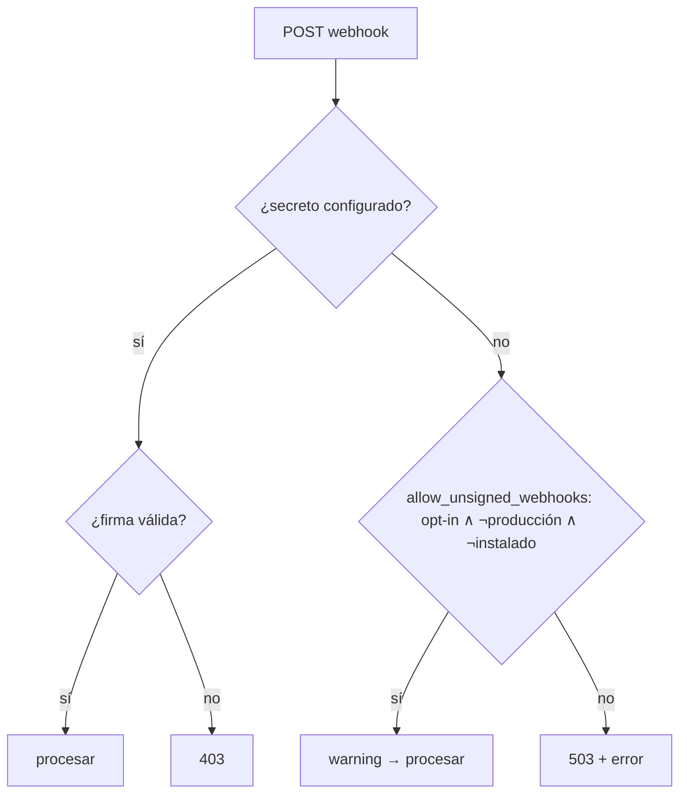

# SDLC-WA-002 — Especificación

- **Intent:** `items/SDLC-WA-002/intent.md` (aprobado el 2026-10-28, Alfred)
- **Nivel:** T1 (microservicio WhatsApp; no toca dinero, esquema ni BD del ERP)
- **Estado:** borrador

## 0. Lo que el código hace hoy (medido en Design)

El intent describía el problema en términos generales. El comportamiento real, leído en el código, es más preciso:

| Situación | `POST /webhook` (Meta) y `POST /webhook/mercadopago` |
|---|---|
| Hay secreto (`get_app_secret()` / `get_mp_webhook_secret()`) | Verifica la firma. Si es inválida responde 403, sin importar `APP_ENV`. ✅ |
| No hay secreto y `is_production()` | 503 (fail-closed, WA-1). ✅ |
| No hay secreto y **cualquier otro entorno** | **Acepta y procesa sin firma**, con un `warning` en el log. ❌ |

- `whatsapp_service/webhook/whatsapp.py:69-89` y `whatsapp_service/webhook/mercadopago.py:36-57` implementan esa tabla.
- `whatsapp_service/config/settings.py:161-171`: `get_app_env()` lee `APP_ENV`, luego `ENVIRONMENT`, y si no hay ninguno usa `"development"`. **Un valor no reconocido** (`"prd"`, `"staging"`) también cae en `development`, sin aviso.
- **Hallazgo que cambia el diseño:** las estaciones instaladas nunca fijan `APP_ENV`. Ni `whatsapp_service/service_host.py` (el host de `spj_whatsapp.exe`) ni el `whatsapp.env` que documenta en las líneas 15-20 lo mencionan, y `installer/` no escribe ningún `whatsapp.env` (grep sin coincidencias). Por eso toda estación instalada corre en `development`.
- `is_production()` gobierna además otras tres cosas:
  - el gate de secretos al arrancar (`whatsapp_service/main.py:59`, `bootstrap/lifecycle.py:27`);
  - la severidad del health check (`bootstrap/health_checks.py:104`);
  - **el bloqueo de escrituras SQLite al ERP** (`whatsapp_service/erp/bridge.py:214,221`). Hoy los pedidos por WhatsApp sólo funcionan por esa vía SQLite, porque los endpoints REST del ERP no existen (SDLC-WA-003).
- Anti-replay de MercadoPago (`whatsapp_service/middleware/hmac_validator.py:57-63`): interpreta `ts` como milisegundos.
  - La documentación oficial muestra `ts=1704908010`. Son 10 dígitos, que sólo tienen sentido como **segundos** (= 2024-01-10; en milisegundos sería enero de 1970).
  - La página no declara la unidad.
  - Si el proveedor envía segundos, `abs(now_ms - ts)` resulta del orden de 1.7·10¹² y **toda notificación firmada se rechaza con 403**.
  - Fuente: [Mercado Pago — Webhooks](https://www.mercadopago.com.mx/developers/en/docs/your-integrations/notifications/webhooks), consultada el 2026-10-28. La misma página indica que el proveedor reintenta cada 15 minutos.
- Pruebas actuales (corrida del 2026-10-28): `test_webhook_production_fail_closed.py`, `test_mercadopago_webhook_signature.py`, `test_main_production_gate.py`, `test_health_checks.py` y `test_lifecycle.py` dan **56 passed, 1 failed**.
  - Falla `test_mercadopago_webhook_signature.py::test_webhook_accepts_valid_signature_and_ignores_non_payment_action`.
  - El test envía el parámetro de consulta como `whatsapp_service.data.id` (líneas 89, 99, 111). La ruta lee `data.id` (`mercadopago.py:30`), así que `data_id` llega `None` y la firma no casa.
  - Consecuencia: **hoy no existe ninguna prueba que pase con una firma válida de extremo a extremo**. Parece un renombrado automático erróneo.

## Comportamiento esperado

La verificación de firma **deja de depender de `APP_ENV`**. Recibir un webhook sin firma pasa a requerir una autorización explícita y acotada a una máquina de desarrollo.

1. **Con secreto:** sin cambios. Firma válida → se procesa. Firma inválida o ausente → 403.
2. **Sin secreto y sin opt-in:** 503, en cualquier entorno, incluido el caso sin `APP_ENV`.
   - El mensaje no se procesa: no se llama al router de mensajes ni a la API de MercadoPago.
   - Se registra `error` con el nombre del secreto faltante y con la forma de habilitar el modo desarrollo. Nunca se registra el valor de un secreto.
3. **Sin secreto y con opt-in válido:** se acepta sin firma con un `warning`, que es la conveniencia de desarrollo de hoy. El opt-in es válido sólo si se cumplen las tres condiciones:
   - `WA_ALLOW_UNSIGNED_WEBHOOKS` vale `1`, `true` o `yes`;
   - `is_production()` es falso;
   - `AppPaths.is_installed` es falso, es decir, se corre desde el código fuente.
4. **Opt-in en producción o en estación instalada:** se ignora. Respuesta 503 y `error` que dice explícitamente que el opt-in fue ignorado y por qué.
5. **`APP_ENV`/`ENVIRONMENT` con un valor no reconocido:** al arrancar se registra un `warning` con el valor leído. La normalización actual (`development`) no cambia; ver D1.
6. **Arranque:** una sola línea de log con el entorno efectivo, `instalado=sí/no` y `webhooks_sin_firma=permitido/bloqueado`. Si queda permitido, el nivel es `warning`.
7. **Health:** un check nuevo, `webhook_signature`, que nunca incluye valores de secretos:
   - HEALTHY si hay secreto de Meta;
   - DEGRADED si no lo hay pero el opt-in es válido;
   - UNHEALTHY si no hay secreto ni opt-in. En ese caso el webhook está rechazando todo y el operador debe saberlo.
8. **Anti-replay de MercadoPago:** la unidad de `ts` se deduce por magnitud.
   - `ts` < 10¹² se trata como segundos; `ts` ≥ 10¹² como milisegundos.
   - Se compara contra el reloj del servidor con la ventana `max_age_seconds`.
   - Un `ts` no numérico se rechaza.
   - Un rechazo por antigüedad se registra con un motivo distinto al de firma inválida, para que los reintentos rechazados sean visibles en el log.

Casos borde:
- **Reintento del proveedor:** Meta y MercadoPago reintentan ante 5xx. Con 503 el proveedor reintentará y seguirá recibiendo 503 hasta que se configure el secreto, lo cual es correcto: no se pierde nada que se haya aceptado. MercadoPago reintenta cada 15 min; la ventana se decide en D2.
- **Replay de una notificación de MercadoPago válida:** el riesgo es acotado, porque el webhook vuelve a consultar el pago real en la API (`mercadopago.py:83`) y aplica idempotencia por `MP-{payment_id}` (`mercadopago.py:133-142`).
- **Offline, concurrencia, permisos, multi-sucursal:** no aplican. Son endpoints HTTP sin estado de sesión; el secreto es por instalación del servicio.

## Diseño

- **Contexto:** sólo el microservicio `whatsapp_service/` (capas config, webhook y middleware). No toca `pos_spj_v13.4/backend` ni la BD.
- **Se reutiliza:**
  - `config/settings.py::get_app_env/is_production`, que siguen siendo la única fuente del entorno;
  - `AppPaths.is_installed` (`backend/shared/app_paths.py:113`), ya importado en `settings.py:35`;
  - `middleware/hmac_validator.py`;
  - `bootstrap/health_checks.py` (mismo patrón que `check_secrets`).
  No se crea un servicio ni un módulo nuevo.
- **Contratos:**
  - `config/settings.py`:
    - nueva `allow_unsigned_webhooks() -> bool`, que implementa la regla 3 y llama a `is_production()` por nombre del módulo para que los `monkeypatch` existentes sigan funcionando;
    - nueva `describe_webhook_security() -> dict`, que devuelve `env`, `installed`, `unsigned_allowed`, `unrecognized_env_value` (sin secretos) y alimenta el log de arranque y el health;
    - `get_app_env()` conserva su firma y su resultado.
  - `webhook/whatsapp.py` y `webhook/mercadopago.py`: la rama `elif is_production(): 503 / else: warning` se sustituye por `elif allow_unsigned_webhooks(): warning / else: 503 + error`. Las dos ramas de 503 comparten un helper pequeño en el mismo módulo para que el texto del error sea uno solo.
  - `middleware/hmac_validator.py::verify_mp_signature`: misma firma pública. Internamente normaliza `ts` a milisegundos antes de comparar. Se actualiza la docstring, que hoy afirma «`ts` is milliseconds».
  - `main.py::lifespan`: registra `describe_webhook_security()` justo después de `_assert_production_secrets_configured()`.
  - `bootstrap/health_checks.py`: nueva `check_webhook_signature()`, registrada donde se registra `check_secrets`.
  - `service_host.py`: la docstring de configuración añade `APP_ENV=production`, explica que `WA_APP_SECRET` es obligatorio para recibir webhooks y que `WA_ALLOW_UNSIGNED_WEBHOOKS` se ignora instalado.

## Datos y migraciones

No hay cambios de esquema ni de datos. **Reversa:** revertir el commit. Como mitigación operativa en una máquina de desarrollo basta `WA_ALLOW_UNSIGNED_WEBHOOKS=1`. En una estación instalada no hay atajo: hay que configurar el secreto, que es el objetivo del cambio.

## Seguridad y auditoría

- Se elimina el fail-open por ausencia de configuración. El único camino sin firma exige una acción explícita en una máquina que no es una estación instalada.
- Logs:
  - `error` en cada rechazo 503;
  - `warning` en cada aceptación sin firma, en un opt-in ignorado y en un `APP_ENV` no reconocido;
  - una línea de estado al arrancar.
  Ningún log ni health contiene valores de secretos; la prueba existente `test_detail_never_contains_a_secret_value` se extiende al check nuevo.
- No hay permisos de usuario involucrados: autenticación de proveedor por HMAC.

## Criterios de aceptación

Cada criterio se verifica con pruebas en `whatsapp_service/tests/` que usan `TestClient` y comprueban efectos: código de respuesta, router o bridge llamados o no (con dobles que registran llamadas) y registros de log (`caplog`).

1. Sin secreto, sin opt-in y sin `APP_ENV`: `POST /webhook` responde 503, el `MessageRouter` doble **no** recibe llamadas y `caplog` contiene un `error` que nombra `WA_APP_SECRET`. Igual para `POST /webhook/mercadopago`, nombrando `MP_WEBHOOK_SECRET`, sin llamada HTTP a la API de pagos.
2. El criterio 1 se cumple igual con `APP_ENV=development`, con `APP_ENV=test` y con `APP_ENV=prd` (valor no reconocido).
3. Sin secreto, con `WA_ALLOW_UNSIGNED_WEBHOOKS=1`, no producción y layout de código fuente: 200 y el router recibe el mensaje. Es el comportamiento de desarrollo de hoy, ahora con opt-in.
4. Con opt-in y `APP_ENV=production`: 503, y el `error` dice que el opt-in se ignoró por producción.
5. Con opt-in y layout instalado (`AppPaths.is_installed` verdadero, simulado): 503, y el `error` dice que se ignoró por estación instalada.
6. Con secreto configurado y firma inválida: 403 con o sin opt-in, en cualquier entorno (regresión de la rama ya correcta).
7. `verify_mp_signature`:
   - acepta una firma válida con `ts` actual en segundos (10 dígitos) y otra con `ts` actual en milisegundos (13 dígitos);
   - rechaza ambas unidades fuera de la ventana;
   - rechaza un `ts` no numérico;
   - el rechazo por antigüedad se registra con un motivo distinto al de firma inválida.
8. La prueba de extremo a extremo con firma válida de MercadoPago envía el parámetro real `data.id` y pasa. Se corrigen las tres ocurrencias de `whatsapp_service.data.id` en `test_mercadopago_webhook_signature.py`.
9. Al arrancar (`lifespan` con dependencias dobladas, o la función de log aislada) se emite exactamente una línea de estado con entorno, instalado y `webhooks_sin_firma`. Es `warning` cuando está permitido, y hay un `warning` adicional ante un `APP_ENV` no reconocido.
10. `check_webhook_signature()` devuelve HEALTHY, DEGRADED o UNHEALTHY según la regla 7, y su detalle nunca contiene un valor de secreto.
11. Las pruebas que hoy fijan el comportamiento anterior se actualizan a la regla nueva, sin borrarse:
    - `test_whatsapp_webhook_allows_with_warning_outside_production` y `test_mercadopago_webhook_allows_with_warning_outside_production` pasan a exigir opt-in;
    - `test_webhook_falls_back_to_unsigned_when_secret_not_configured` pasa a exigir opt-in, y se agrega su par sin opt-in que espera 503.
12. Toda la suite de `whatsapp_service/tests/` no tiene fallas nuevas respecto a la línea base que Build medirá **antes** del primer cambio. `tests/architecture` no suma fallas a las 22 de `docs/sdlc/baseline/2026-10-28.md`.

## Pruebas de regresión antes del cambio

Lo exige T1 y es recomendable aquí. Antes de tocar código, Build:
- corre y guarda la salida completa de `python -m pytest whatsapp_service/tests -q`;
- fija con una prueba nueva el contrato que no debe moverse: con secreto, una firma inválida da 403 en los dos webhooks y en los tres entornos.

## Riesgos y alternativas descartadas

- **Riesgo operativo (esperado):** una estación instalada con el servicio local y **sin `WA_APP_SECRET`** pasará de aceptar webhooks sin firma a responder 503. Dejará de recibir mensajes de WhatsApp hasta que se configure el secreto. Es la vulnerabilidad que se cierra. Mitigación: nota de release, health UNHEALTHY con un mensaje accionable y el error en el log. Ver D3.
- **Riesgo de unidad de `ts`:** si el proveedor llegara a mandar otra escala (microsegundos), la deducción por magnitud fallaría cerrado (rechazo), no abierto.
- **Descartado: cambiar el default de `get_app_env()` a `production`** (opción A de D1). Apagaría también las escrituras SQLite del bridge (`bridge.py:214`). Con los endpoints REST inexistentes (SDLC-WA-003), eso detendría los pedidos por WhatsApp en toda estación instalada. Además el gate de `main.py:59` impediría arrancar a cualquier estación a la que le falte uno de los cinco secretos, aunque sólo use mensajes salientes.
- **Descartado: producción por defecto sólo en estación instalada** (opción C de D1). Mismo efecto sobre el bridge en las estaciones, que es justo donde corre hoy.
- **Fuera de alcance, anotado:**
  - si `data.id` no viene en la notificación, el manifiesto se construye con `id:;`. La documentación sugiere omitir los campos ausentes (**no verificado**); va al backlog sólo si Build lo confirma;
  - el matching del pago es SDLC-WA-001;
  - el contrato REST es SDLC-WA-003.

## Decisiones que requieren aprobación

- **D1 — ¿Dónde se aplica el fail-closed?**
  - (A) cambiar el default global de `APP_ENV` a `production`;
  - (B) desacoplar sólo la verificación de firma de `APP_ENV`, con opt-in explícito para desarrollo, y dejar los demás usos de `is_production()` como están hasta SDLC-WA-003;
  - (C) producción por defecto cuando `AppPaths.is_installed`.

  **Recomiendo B:** cierra el agujero sin apagar el único camino por el que hoy funcionan los pedidos por WhatsApp. A y C se pueden reconsiderar al cerrar WA-003.
- **D2 — Ventana anti-replay de MercadoPago.**
  - (A) mantener 300 s;
  - (B) hacerla configurable (`MP_SIGNATURE_MAX_AGE_SECONDS`, default 300) y registrar el rechazo por antigüedad con motivo propio;
  - (C) ampliarla por defecto (p. ej. 3600 s) para no rechazar reintentos.

  **Recomiendo B.** No está verificado si los reintentos cada 15 min re-firman con un `ts` nuevo. Con el log distinto se verá en la primera semana, y el replay ya está acotado por la consulta a la API y la idempotencia. Si el responsable sabe que los reintentos conservan el `ts` original, conviene C.
- **D3 — Despliegue en estaciones instaladas sin `WA_APP_SECRET`.**
  - (A) fail-closed inmediato con nota de release y health UNHEALTHY;
  - (B) un release de gracia en que sólo se registra la advertencia y se bloquea en el siguiente.

  **Recomiendo A:** es un hueco de seguridad activo y la corrección operativa (capturar el secreto en el módulo WhatsApp) ya existe (`settings.py:102-110`).
- **Pregunta del intent (no bloqueante):** «¿hay hoy algún despliegue sin `APP_ENV=production`?». El código responde que **toda estación instalada** lo está. Falta saber si alguna tiene el servicio local activo y sin secreto, porque esa es la que D3 afectaría.
